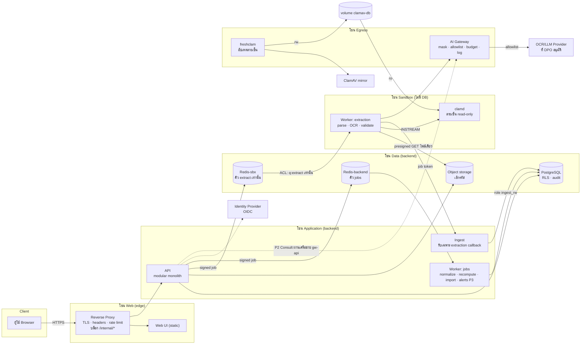
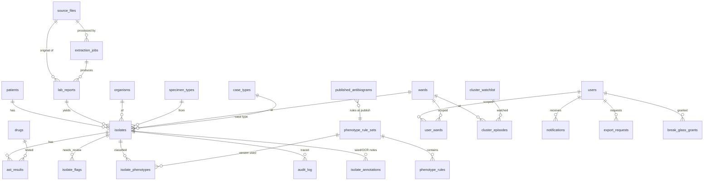
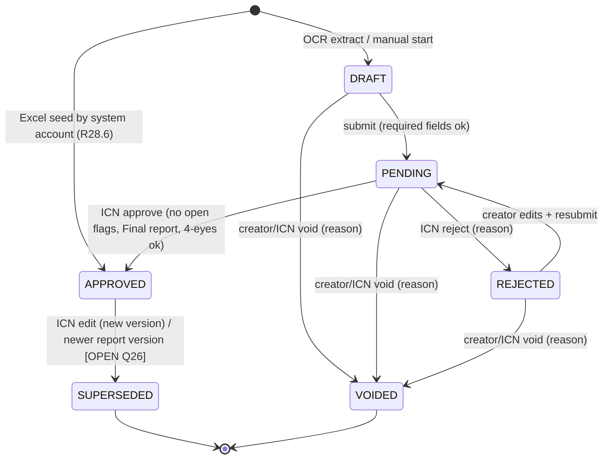
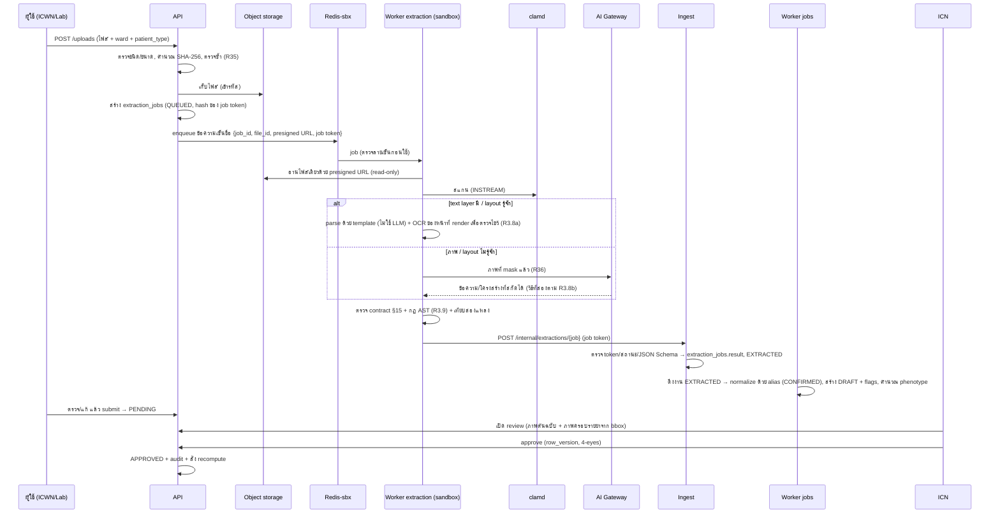

# System Design — IC MDR & Antibiogram Analytics (Phase P0–P1) — Revision 2

> **Revision 2** = rev1 + การแก้ตาม `review_SE_process.md` (D1–D14, A1–A5, N1–N3) ; รายการแก้ดู §17 "Change Log rev1 → rev2" ; ADR ที่เกี่ยวข้องอยู่ใน `docs/adr/`
> สอดคล้องกับ `requirements_IC_MDR.md` (**v4.1**) · ขอบเขต: **P0 Foundation + P1 Core** ; P2 (AI Consult) และ P3 (Alerts) ระบุเป็น "จุดต่อ" (extension points) เท่านั้น
> สถานะ: **ร่างสำหรับทบทวน** — ทุกการตัดสินใจที่ยังไม่ได้รับการยืนยันติดป้าย `[PROPOSED]` หรือ `[OPEN Qn]` ; **SQL ใน rev2 ยังไม่ได้รันกับ PostgreSQL จริง** — พฤติกรรม RLS, `NULLS NOT DISTINCT`, advisory lock, `security_invoker` เป็นข้อสรุปจากเอกสาร/ความรู้ `[unverified]` ต้องยืนยันด้วย test บน PostgreSQL จริงใน Inc 1
> เอกสารคู่กัน: `deployment_IC_MDR.md` (rev2) + ชุดไฟล์ `deploy/` (**ไม่อยู่ใน workspace นี้** — ต้องปรับให้ตรง rev2 เมื่อเพิ่มเข้ามา)
> ป้ายกำกับ: `[F]` ข้อเท็จจริงจากไฟล์ · `[R]` ข้อสรุปของผม · `[J]` ต้องให้ผู้มีอำนาจ/ผู้เชี่ยวชาญตัดสิน

## 1. หลักการออกแบบและข้อสมมติ

### 1.1 หลักการ
1. **Deterministic ก่อน AI** — %S, first isolate, phenotype, cluster เป็น pure functions ในแพ็กเกจ `domain` ที่ไม่พึ่ง DB/เครือข่าย (NFR-8)
2. **ทุกอย่างที่มาจากภายนอกเป็นข้อมูลไม่น่าเชื่อถือ** — ไฟล์, ผล OCR, ข้อความจาก LLM, ข้อมูลใน Excel
3. **สิทธิ์น้อยที่สุด** — extraction ไม่มีสิทธิ์ DB; AI gateway เป็นทางออกเดียว; DB ป้องกันซ้ำด้วย RLS
4. **ทำซ้ำได้** — สถิติที่เผยแพร่เป็น snapshot; กฎ/ค่าตั้งมีเวอร์ชัน
5. **เรียบง่ายตามขนาดจริง** `[F]` ข้อมูล ~4.7 พันแถว (2026 ถึง ก.ย. = 3,548) `[R]` ไม่จำเป็นต้องมี microservices

### 1.2 ข้อสมมติเชิงสถาปัตยกรรม (ต้องยืนยัน)
> rev2: เปลี่ยนรหัสข้อสมมติจาก A1–A5 เป็น **AS1–AS5** เพื่อไม่ให้ชนกับ finding A1–A5 (RLS) ของ `review_SE_process.md` ; เนื้อหาไม่เปลี่ยน

| ID | ข้อสมมติ | ผลถ้าผิด |
|---|---|---|
| AS1 `[OPEN Q21]` | ติดตั้งในโรงพยาบาล/private cloud ด้วย Docker Compose (1–2 โฮสต์) | ถ้าเป็นคลาวด์/Kubernetes ปรับ `deploy/` เป็น Helm/Terraform ; ตรรกะแอปไม่เปลี่ยน |
| AS2 `[OPEN Q21]` | มี OIDC IdP ของโรงพยาบาล ถ้าไม่มีใช้ Keycloak | ไม่มี IdP → ต้องเพิ่มงานจัดการบัญชี/MFA ภายใน |
| AS3 `[OPEN Q12]` | แล็บต้นทางมีหลาย layout ; เริ่มจาก layout ของโรงพยาบาล 2 แบบ | ขนาดงาน extraction เปลี่ยน |
| AS4 `[OPEN Q6]` | OCR/LLM ภายนอกยังไม่ได้รับอนุมัติ → ออกแบบให้ทำงานได้ทั้งแบบภายในและภายนอกผ่าน adapter | ถ้าต้องภายในเท่านั้น ต้องจัดสรรทรัพยากรประมวลผล |
| AS5 | ผู้ใช้ ~หลักสิบ (ICN/ICWN/Lab/แพทย์/ผู้บริหาร) ไม่ใช่หลักพัน | ถ้ามากกว่านี้มาก ตรวจ capacity ใหม่ |

## 2. ภาพรวมสถาปัตยกรรม

### 2.1 Container view `[Changed rev2 — N1, N2, N3]`

ความต่างจาก rev1: (N1) worker เรียก **ingest** แทน API — API หลักไม่อยู่บนเครือข่าย sandbox ; (N2) คิวของ sandbox แยกเป็น `redis-sbx` + ACL + ข้อความงานเซ็นชื่อ ; (N3) `freshclam` (egress) แยกจาก `clamd` (sandbox) ใช้ volume ลายเซ็นร่วม โดย `clamd` อ่านอย่างเดียว ; รายละเอียดเครือข่าย §2.5

### 2.2 Components
| Component | หน้าที่ | สิทธิ์/ข้อจำกัดสำคัญ | Req |
|---|---|---|---|
| Reverse Proxy | TLS, security headers, rate limit, route | ไม่เก็บข้อมูล ; คืน 404 สำหรับ `/internal/*` | R52 |
| Web UI | SPA: Dashboard, Antibiogram, Upload/Review, Database, Master/Rules, Admin | ไม่มี secret ; ไม่เรียก LLM | R7–R14 |
| API (modular monolith) | AuthN/Z, workflow, analytics, master data, audit, file signing | เป็นเจ้าของ DB เพียงรายเดียวของข้อมูลธุรกิจ ; **ไม่อยู่บนเครือข่าย sandbox** (rev2) | ทั้งหมด |
| Ingest `[New rev2 — N1]` | รับผล extraction จาก worker: ตรวจ job token, ตรวจ JSON Schema (§15), เก็บผลใน `extraction_jobs` | entrypoint แยกของโค้ดเดียวกับ API แต่มีเพียง route `POST /internal/extractions/{job}` ; DB role `ingest_rw` (อ่าน/อัปเดต `extraction_jobs` เท่านั้น) ; จำกัดขนาด body และอัตรา | R41.3 |
| Worker: jobs | normalize ผล extraction → DRAFT, recompute, import, scheduled reports, alerts (P3) | ต่อ DB ด้วย role แยก (สิทธิ์จำกัดตารางที่ต้องใช้) | R33, R28, R3.11 |
| Worker: extraction | parse/OCR/validate/แปลง พ.ศ. | **ไม่มี DB credential, ไม่มีเครือข่ายออก** ยกเว้น `redis-sbx` (ACL), object storage (presigned GET ไฟล์เดียว), `clamd`, ingest, AI gateway | R3, R41 |
| clamd `[Changed rev2 — N3]` | สแกนไฟล์ก่อนประมวลผล | อยู่บน sandbox เท่านั้น ; mount ลายเซ็นแบบ read-only ; ไม่มีเครือข่ายออก | R41.2 |
| freshclam `[New rev2 — N3]` | ดาวน์โหลดลายเซ็น ClamAV | อยู่บน egress เท่านั้น (ออกได้เฉพาะ mirror) ; เขียน volume ลายเซ็น ; ไม่รับไฟล์ผู้ใช้ | R41.2 |
| AI Gateway | ทางออกเดียวไป OCR/LLM ภายนอก | allowlist, masking, budget, log ไม่มี PHI | R42, R36 |
| PostgreSQL | ข้อมูลหลัก + RLS + audit | ไม่เปิดสู่ภายนอก ; อยู่บน backend เท่านั้น | R43, R29 |
| Object storage | ไฟล์ต้นฉบับ (immutable, hash) | เข้ารหัส ; เข้าถึงผ่าน signed URL ; worker ไม่มีคีย์ | R36 |
| Redis-backend `[Changed rev2 — N2]` | คิวงานของ worker-jobs | backend เท่านั้น ; ACL ต่อ service ; sandbox เข้าถึงไม่ได้ | R41 |
| Redis-sbx `[New rev2 — N2]` | คิวงาน extraction เท่านั้น | ACL: ผู้ผลิต (api, worker-jobs) เขียนได้เฉพาะ prefix `q:extract:` ; worker-extract อ่าน/ack ได้เฉพาะ prefix เดียวกัน ; ปิด default user ; ไม่เก็บ PHI (ส่งเฉพาะ job ID) | R41 |
| migrate `[New rev2 — N4]` | รัน Alembic แบบ one-off | `docker compose run --rm migrate` ; secret ของ role `migrator` เฉพาะตัว ; ไม่รันค้าง | R52.2 |

### 2.3 Tech stack `[PROPOSED]` (ตัดสินร่วมกับทีมโรงพยาบาลก่อนเริ่มโค้ด)
| ชั้น | ค่าเริ่มต้นที่เสนอ | ทางเลือก | เหตุผล `[R]` |
|---|---|---|---|
| API/Workers | Python 3.12 + FastAPI + SQLAlchemy 2 + Alembic | TypeScript (NestJS/Fastify) | ไลบรารี PDF/OCR และการประมวลผลข้อมูลสะดวก ; กฎโดเมนเขียนเป็น pure functions ง่าย |
| Web | React + TypeScript + Vite ; ตาราง TanStack Table ; กราฟ ECharts/Chart.js | — | prototype เดิมใช้ Tailwind + Chart.js |
| DB | PostgreSQL | — | RLS, JSONB, ธุรกรรม |
| Queue | Redis (ACL users ต่อ service ; แยก `redis-sbx` กับ `redis-backend` — rev2, ADR-003) | broker อื่น | ทำให้ worker ไม่ต้องมี DB credential (R41) |
| Object storage | MinIO (S3-compatible) | S3/ที่เก็บของโรงพยาบาล | on-prem |
| Proxy | Caddy หรือ nginx | — | TLS อัตโนมัติ/ภายใน |
| IdP | OIDC ของโรงพยาบาล ; Keycloak ถ้าไม่มี | — | MFA, SSO |
| AV | ClamAV (`clamd` + `freshclam` แยก container — rev2, ADR-004) | — | R41.2 |
| Observability | Prometheus + Grafana + Loki (ไม่เก็บ PHI) | — | NFR-9 |
> เวอร์ชันของทุกอย่างให้ตรึงใน lockfile/ไดเจสต์ของอิมเมจ ผมไม่ได้กำหนดเลขเวอร์ชันในเอกสารนี้

### 2.4 โครงสร้างโค้ด (monorepo)
```
apps/api/            # FastAPI: routers, services, repositories, authz
apps/worker_jobs/    # jobs ที่ใช้ DB
apps/worker_extract/ # sandbox worker (ไม่ import repository/DB)
apps/ai_gateway/     # gateway (stub ใน P1)
apps/web/            # React SPA
packages/domain/     # pure functions: first_isolate, antibiogram, phenotype, cluster, validators
packages/contracts/  # JSON Schema/Pydantic: extraction schema, API DTOs
packages/importers/  # seed importer (CLI)
db/migrations/       # Alembic
deploy/              # compose, proxy, scripts, CI
docs/                # requirements, design, runbooks
tests/               # unit, property, golden, authz-matrix, e2e
```
กฎ: `packages/domain` ห้าม import อะไรนอกจาก stdlib/ชนิดข้อมูล ; `worker_extract` ห้าม import DB layer (บังคับด้วย lint rule — `import-linter` ใน CI)
rev2: ingest เป็น entrypoint แยกใน `apps/api/` (เช่น `apps/api/ingest_main.py`) ที่ประกอบเฉพาะ router callback ; `packages/contracts/extraction.schema.json` (§15) และ `packages/contracts/phenotype_rule.schema.json` (§16) เป็นสัญญากลาง

### 2.5 เครือข่ายและขอบเขตความเชื่อถือ `[New rev2 — N1, N2, N3]` `[PROPOSED]`
| เครือข่าย | สมาชิก | เหตุผล |
|---|---|---|
| `edge` | proxy, api | proxy เป็นจุดเดียวที่เปิดพอร์ต |
| `backend` (internal) | api, worker-jobs, ingest, db, redis-backend, redis-sbx, minio, migrate (one-off) | DB อยู่ที่นี่เท่านั้น |
| `sandbox` (internal) | worker-extract, clamd, ingest, redis-sbx, minio, ai-gateway | ไม่มี api และไม่มี db (N1) |
| `egress` | ai-gateway, freshclam | ทางออกนอกเครือข่าย ; ต้องจำกัดปลายทางที่ไฟร์วอลล์โฮสต์ |
| `gw-api` (internal, เปิดใน P2) | api, ai-gateway | เส้นทาง AI Consult โดยไม่ให้ api อยู่บน sandbox |

**N1 — ingest:** worker ส่งผลได้ที่ `POST /internal/extractions/{job}` ของ ingest เท่านั้น ; ingest ไม่มี route อื่น จึงเรียก endpoint ของ API ไม่ได้แม้ worker ถูกเจาะ ; ingest ตรวจ (1) job token เทียบ `extraction_jobs.job_token_hash` และวันหมดอายุ (2) สถานะงานยังรับผลได้ (3) JSON Schema §15 (4) ขนาด/จำนวนหน้า แล้วเก็บผลใน `extraction_jobs.result` สถานะ `EXTRACTED` ; worker-jobs ดึงงาน `EXTRACTED` ด้วย `FOR UPDATE SKIP LOCKED` แล้ว normalize → DRAFT (ไม่ต้องให้ ingest มีสิทธิ์เขียนคิว backend)
**N2 — คิว:** แยก `redis-sbx` (เฉพาะคิว extract) จาก `redis-backend` ; ทั้งสองปิด default user และใช้ ACL ต่อ service จำกัด key prefix และคำสั่ง ; ข้อความงานมีเพียง `job_id`, `file_id`, presigned URL อายุสั้น, job token และลายเซ็น Ed25519 ของผู้ผลิต — ผู้บริโภคตรวจด้วย public key (worker ที่ถูกเจาะจึงปลอมงานให้ผู้บริโภคอื่นไม่ได้) ; **payload ทุกชนิดเป็นข้อมูลไม่น่าเชื่อถือ** ตรวจ schema ก่อนใช้ ; ทางเลือก: Redis เดียว + ACL prefix (ง่ายกว่า แต่ sandbox เห็น instance เดียวกับ backend) — ADR-003
**N3 — ClamAV:** `freshclam` บน egress เขียนลายเซ็นลง volume `clamav-db` ; `clamd` บน sandbox mount volume เดียวกันแบบ `:ro` และโหลดลายเซ็นใหม่ตามรอบ SelfCheck `[unverified]` ; ไม่มี container ใดอยู่ทั้ง egress และ sandbox ยกเว้น ai-gateway (ซึ่งเป็นทางออกที่ควบคุมแล้ว) — ADR-004
ข้อจำกัด `[R]`: เครือข่าย compose ไม่จำกัดพอร์ตระหว่างสมาชิกเครือข่ายเดียวกัน ; redis-sbx และ minio เป็นสมาชิกทั้ง backend และ sandbox จึงต้องพึ่ง ACL/bucket policy ; ทางเลือกที่แคบกว่าคือให้ ingest ส่งไฟล์ให้ worker แทน presigned URL (minio ออกจาก sandbox) — ยังไม่เลือก

## 3. โมเดลข้อมูล

### 3.1 ERD (ย่อ)

rev2: เพิ่ม `isolate_annotations`, `case_types`, `extraction_jobs`, `cluster_watchlist`, `cluster_episodes`, `notifications`, `export_requests`, `break_glass_grants`, `specimen_aliases`, `case_type_aliases` (D6, D7) และ view `approved_isolates` (D1)

### 3.2 DDL หลัก `[PROPOSED]` (PostgreSQL ; migrations ด้วย Alembic)
> rev2: **ต้องใช้ PostgreSQL 15 ขึ้นไป** เพราะใช้ `UNIQUE NULLS NOT DISTINCT` (D10) และ view `security_invoker` (D1/A1) ; ถ้าต้องใช้รุ่นต่ำกว่า ให้เปลี่ยนเป็น `NOT NULL` + ค่า sentinel (เช่น `''`) และ view ธรรมดาที่ owner ไม่ bypass RLS ; ไวยากรณ์ตรวจด้วย parser เท่านั้น `[unverified]` บนฐานข้อมูลจริง
```sql
-- ===== Master data =====
CREATE TABLE wards (
  id serial PRIMARY KEY, code text UNIQUE NOT NULL, name text NOT NULL,
  ward_type text NOT NULL CHECK (ward_type IN ('ICU','NON_ICU')),
  ward_group text, active boolean NOT NULL DEFAULT true);
-- rev2 (D7): ทุกตาราง alias มีสถานะ PROPOSED/CONFIRMED (R28.7) ; การจับคู่ใช้เฉพาะ CONFIRMED
CREATE TABLE ward_aliases (alias_norm text PRIMARY KEY, ward_id int NOT NULL REFERENCES wards,
  status text NOT NULL DEFAULT 'PROPOSED' CHECK (status IN ('PROPOSED','CONFIRMED')),
  proposed_from text, confirmed_by uuid, confirmed_at timestamptz,
  CONSTRAINT ward_alias_confirmed CHECK (status <> 'CONFIRMED' OR (confirmed_by IS NOT NULL AND confirmed_at IS NOT NULL)));

CREATE TABLE organisms (
  id serial PRIMARY KEY, canonical_name text UNIQUE NOT NULL,
  org_class text NOT NULL CHECK (org_class IN ('BACTERIA','YEAST','MYCOBACTERIA','OTHER')),
  gram text, mdr_group text, active boolean NOT NULL DEFAULT true);
CREATE TABLE organism_aliases (alias_norm text PRIMARY KEY, organism_id int NOT NULL REFERENCES organisms,
  status text NOT NULL DEFAULT 'PROPOSED' CHECK (status IN ('PROPOSED','CONFIRMED')),
  proposed_from text, confirmed_by uuid, confirmed_at timestamptz,
  CONSTRAINT organism_alias_confirmed CHECK (status <> 'CONFIRMED' OR (confirmed_by IS NOT NULL AND confirmed_at IS NOT NULL)));

-- rev2 (D10): concentration ว่างได้ → NULLS NOT DISTINCT (PG15+) มิฉะนั้นแถว (name, method, NULL) ซ้ำได้
-- rev2 (D4): code = รหัสคงที่ข้าม environment ใช้อ้างใน rule DSL (§16) แทน id
CREATE TABLE drugs (
  id serial PRIMARY KEY, code text UNIQUE NOT NULL, name text NOT NULL, drug_class text, display_order int,
  method text NOT NULL DEFAULT 'unspecified', concentration text,
  active boolean NOT NULL DEFAULT true,
  CONSTRAINT drugs_name_method_conc_key UNIQUE NULLS NOT DISTINCT (name, method, concentration));
CREATE TABLE drug_aliases (alias_norm text PRIMARY KEY, drug_id int NOT NULL REFERENCES drugs,
  status text NOT NULL DEFAULT 'PROPOSED' CHECK (status IN ('PROPOSED','CONFIRMED')),
  proposed_from text, confirmed_by uuid, confirmed_at timestamptz,
  CONSTRAINT drug_alias_confirmed CHECK (status <> 'CONFIRMED' OR (confirmed_by IS NOT NULL AND confirmed_at IS NOT NULL)));

CREATE TABLE specimen_types (id serial PRIMARY KEY, name text UNIQUE NOT NULL,
  category text NOT NULL CHECK (category IN ('BLOOD','RESPIRATORY','URINE','WOUND','OTHER')),
  active boolean NOT NULL DEFAULT true);
-- rev2 (D7): R3.7/R28.7 ต้องมี alias ของ specimen ด้วย
CREATE TABLE specimen_aliases (alias_norm text PRIMARY KEY, specimen_type_id int NOT NULL REFERENCES specimen_types,
  status text NOT NULL DEFAULT 'PROPOSED' CHECK (status IN ('PROPOSED','CONFIRMED')),
  proposed_from text, confirmed_by uuid, confirmed_at timestamptz,
  CONSTRAINT specimen_alias_confirmed CHECK (status <> 'CONFIRMED' OR (confirmed_by IS NOT NULL AND confirmed_at IS NOT NULL)));

-- rev2 (D7, Q11): master ของ Case Type (HAI) ; is_hai ว่างจนกว่า ICN ยืนยัน (R7.2 นับ HAI จากค่านี้)
CREATE TABLE case_types (id serial PRIMARY KEY, code text UNIQUE NOT NULL, name text NOT NULL,
  is_hai boolean, active boolean NOT NULL DEFAULT true);
CREATE TABLE case_type_aliases (alias_norm text PRIMARY KEY, case_type_id int NOT NULL REFERENCES case_types,
  status text NOT NULL DEFAULT 'PROPOSED' CHECK (status IN ('PROPOSED','CONFIRMED')),
  proposed_from text, confirmed_by uuid, confirmed_at timestamptz,
  CONSTRAINT case_type_alias_confirmed CHECK (status <> 'CONFIRMED' OR (confirmed_by IS NOT NULL AND confirmed_at IS NOT NULL)));

-- ===== Rules & configuration (versioned) =====
CREATE TABLE phenotype_rule_sets (
  id serial PRIMARY KEY, version int UNIQUE NOT NULL,
  status text NOT NULL CHECK (status IN ('DRAFT','ACTIVE','RETIRED')),
  signed_by uuid, signed_at timestamptz, notes text);
-- rev2 (D4): definition ต้องผ่าน JSON Schema ของ rule DSL v1 (§16) ก่อนบันทึก ; ตรวจที่ service (R49)
CREATE TABLE phenotype_rules (
  id serial PRIMARY KEY, rule_set_id int NOT NULL REFERENCES phenotype_rule_sets,
  code text NOT NULL, applies_to_mdr_group text, definition jsonb NOT NULL, is_mdro boolean NOT NULL,
  dsl_version int NOT NULL DEFAULT 1, UNIQUE (rule_set_id, code));
CREATE TABLE sdd_allowed (rule_set_id int REFERENCES phenotype_rule_sets, drug_id int REFERENCES drugs,
  mdr_group text, PRIMARY KEY (rule_set_id, drug_id, mdr_group));
CREATE TABLE intrinsic_resistance (organism_id int REFERENCES organisms, drug_id int REFERENCES drugs,
  PRIMARY KEY (organism_id, drug_id));
CREATE TABLE config_items (key text PRIMARY KEY, value jsonb NOT NULL, version int NOT NULL, updated_by uuid, updated_at timestamptz NOT NULL DEFAULT now());
CREATE TABLE config_history (id bigserial PRIMARY KEY, key text, old_value jsonb, new_value jsonb, reason text, changed_by uuid, changed_at timestamptz NOT NULL DEFAULT now());

-- rev2 (D7): รายการเฝ้าระวัง cluster ที่ ICN ดูแล (R11.2, Q17) — เปลี่ยนผ่าน R49 ; เก็บเวอร์ชัน
CREATE TABLE cluster_watchlist (
  id serial PRIMARY KEY, organism_id int REFERENCES organisms, phenotype_code text,
  active boolean NOT NULL DEFAULT true, config_version int NOT NULL,
  added_by uuid NOT NULL, added_at timestamptz NOT NULL DEFAULT now(), reason text,
  CONSTRAINT watch_target CHECK (organism_id IS NOT NULL OR phenotype_code IS NOT NULL));

-- ===== Identity =====
-- rev2 (D12): role ค่าเดียวต่อผู้ใช้ เป็นค่าสมมติ [OPEN Q27] ; ถ้าตอบว่าหลายบทบาท → ย้ายไป user_roles (ด้านล่าง, ปิดไว้)
-- rev2 (D2): เพิ่ม role 'SYSTEM' + is_system สำหรับบัญชีระบบ เช่น 'system:excel-seed' (login ไม่ได้: active=false, idp_subject NULL)
CREATE TABLE users (id uuid PRIMARY KEY DEFAULT gen_random_uuid(), username text UNIQUE NOT NULL, display_name text,
  role text NOT NULL CHECK (role IN ('ICN','ICWN','LAB','PHARMACIST','DOCTOR','EXECUTIVE','ADMIN','SYSTEM')),
  is_system boolean NOT NULL DEFAULT false,
  active boolean NOT NULL DEFAULT true, idp_subject text UNIQUE,
  deactivated_at timestamptz, last_idp_sync_at timestamptz,                -- R55 [PROPOSED v4.1]
  CONSTRAINT system_role_only_for_system CHECK ((role = 'SYSTEM') = is_system),
  CONSTRAINT system_cannot_login CHECK (NOT is_system OR (active = false AND idp_subject IS NULL)));
CREATE TABLE user_wards (user_id uuid REFERENCES users, ward_id int REFERENCES wards, PRIMARY KEY (user_id, ward_id));
-- [OPEN Q27] ทางเลือกหลายบทบาท:
-- CREATE TABLE user_roles (user_id uuid REFERENCES users, role text NOT NULL, PRIMARY KEY (user_id, role));
INSERT INTO users (username, display_name, role, is_system, active)
  VALUES ('system:excel-seed', 'Excel seed importer (system account)', 'SYSTEM', true, false);

-- ===== Clinical data =====
CREATE TABLE patients (hn text PRIMARY KEY, sex text, name_enc bytea  /* NULL by default (R30) */);

CREATE TABLE source_files (
  id uuid PRIMARY KEY DEFAULT gen_random_uuid(), sha256 text UNIQUE NOT NULL, storage_key text NOT NULL,
  mime text NOT NULL, size_bytes bigint NOT NULL, uploaded_by uuid, uploaded_at timestamptz NOT NULL DEFAULT now(),
  scan_status text NOT NULL DEFAULT 'PENDING' CHECK (scan_status IN ('PENDING','CLEAN','REJECTED')),
  retention_until date,
  retention_rule_version int, legal_hold boolean NOT NULL DEFAULT false,      -- R54 [PROPOSED v4.1]
  purged_at timestamptz, purged_by uuid);                                     -- เก็บ hash/metadata หลังลบ object

-- rev2 (D7): งาน extraction ; token ต่องานเก็บเฉพาะ hash ; ไม่มี PHI ในคอลัมน์ใด (error เป็นรหัส)
CREATE TABLE extraction_jobs (
  id uuid PRIMARY KEY DEFAULT gen_random_uuid(),
  source_file_id uuid NOT NULL REFERENCES source_files,
  status text NOT NULL DEFAULT 'QUEUED' CHECK (status IN
    ('QUEUED','RUNNING','EXTRACTED','SUCCEEDED','FAILED','MANUAL_REQUIRED','DEAD_LETTER')),
  attempts int NOT NULL DEFAULT 0, max_attempts int NOT NULL,                 -- ค่าจาก config (R46.2)
  job_token_hash bytea NOT NULL, token_expires_at timestamptz NOT NULL,
  schema_version text, layout text, last_error_code text,
  result jsonb,                                  -- ผลที่ผ่าน JSON Schema §15 แล้ว (ingest เขียน) ; ยังเป็นข้อมูลไม่น่าเชื่อถือ
  requested_by uuid NOT NULL,                    -- ผู้อัปโหลด → created_by ของ DRAFT
  context jsonb NOT NULL DEFAULT '{}'::jsonb,    -- ward/patient_type จากขั้น context (R3.4)
  created_at timestamptz NOT NULL DEFAULT now(), updated_at timestamptz NOT NULL DEFAULT now(),
  CONSTRAINT attempts_bounded CHECK (attempts >= 0 AND attempts <= max_attempts));
CREATE INDEX ON extraction_jobs (status, updated_at);

-- rev2 (D10): lab_no/order_no ว่างได้ → UNIQUE แบบเดิมไม่กันซ้ำ ; ใช้ unique index NULLS NOT DISTINCT
--   เฉพาะแถวที่มี lab_no หรือ order_no อย่างน้อยหนึ่งค่า (ใบที่อ่านเลขไม่ได้ทั้งคู่ไปตรวจซ้ำแบบ R31 แทน)
CREATE TABLE lab_reports (
  id uuid PRIMARY KEY DEFAULT gen_random_uuid(), source_lab text NOT NULL, lab_no text, order_no text,
  version int NOT NULL DEFAULT 1, report_status text NOT NULL CHECK (report_status IN ('FINAL','PRELIMINARY','UNKNOWN')),
  ordered_at timestamptz, lab_received_at timestamptz, reported_at timestamptz,
  source_file_id uuid REFERENCES source_files, supersedes_id uuid REFERENCES lab_reports,
  extraction_job_id uuid REFERENCES extraction_jobs,
  extraction_report jsonb);
CREATE UNIQUE INDEX lab_reports_key ON lab_reports (source_lab, lab_no, order_no, version)
  NULLS NOT DISTINCT WHERE lab_no IS NOT NULL OR order_no IS NOT NULL;

CREATE SEQUENCE isolate_code_seq;
CREATE TABLE isolates (
  id uuid PRIMARY KEY DEFAULT gen_random_uuid(),
  isolate_code text UNIQUE NOT NULL DEFAULT ('ISO-' || to_char(now(),'YYYY') || '-' || lpad(nextval('isolate_code_seq')::text,6,'0')),
  patient_hn text NOT NULL REFERENCES patients, lab_report_id uuid REFERENCES lab_reports,
  specimen_date date NOT NULL, specimen_type_id int REFERENCES specimen_types, specimen_detail text,
  ward_id int REFERENCES wards,                       -- NULL only when source='EXCEL_SEED' (CHECK below)
  patient_type text CHECK (patient_type IN ('OPD','IPD')),
  organism_id int NOT NULL REFERENCES organisms, organism_qualifier text,
  case_type_id int REFERENCES case_types, case_type_raw text,               -- rev2 (D7): เดิม case_type text
  lab_comments text,
  next_appointment_date date,                                              -- rev2 (D6): R1.2, R3.4, R17
  culture_clearance_status text CHECK (culture_clearance_status IN
    ('NEW','AWAITING_1','AWAITING_2','AWAITING_3','CLEARED')),             -- rev2 (D6): R18 (P3) ; ค่าตาม R18.1
  notes text, asp_flag boolean NOT NULL DEFAULT false,                     -- rev2 (D6): R1.2 Notes/ASP flag
  -- rev2 (D9): เพิ่ม VOIDED
  status text NOT NULL CHECK (status IN ('DRAFT','PENDING','APPROVED','REJECTED','SUPERSEDED','VOIDED')),
  source text NOT NULL CHECK (source IN ('OCR','MANUAL','EXCEL_SEED')),
  version int NOT NULL DEFAULT 1, row_version int NOT NULL DEFAULT 1,   -- row_version: optimistic lock
  supersedes_id uuid REFERENCES isolates, reject_reason text,
  void_reason text, voided_by uuid, voided_at timestamptz,               -- rev2 (D9)
  created_by uuid, created_at timestamptz NOT NULL DEFAULT now(), last_edited_by uuid,
  approved_by uuid, approved_at timestamptz,
  data_quality_flags jsonb NOT NULL DEFAULT '{}'::jsonb, import_batch_id uuid,
  source_row_hash text UNIQUE,      -- rev2 (D6): R28.9 กันนำเข้าซ้ำ ; NULL สำหรับแถวที่ไม่ใช่ seed (NULL ไม่ชนกันโดยตั้งใจ)
  CONSTRAINT ward_required_for_new CHECK (ward_id IS NOT NULL OR source = 'EXCEL_SEED'),
  CONSTRAINT approved_has_approver CHECK (status <> 'APPROVED' OR (approved_by IS NOT NULL AND approved_at IS NOT NULL)),
  -- rev2 (D2): แถว seed ต้องผูก batch และมี row hash ; approved_by = id ของ 'system:excel-seed', approved_at = เวลา commit
  CONSTRAINT seed_has_batch CHECK (source <> 'EXCEL_SEED' OR (import_batch_id IS NOT NULL AND source_row_hash IS NOT NULL)),
  CONSTRAINT voided_has_reason CHECK (status <> 'VOIDED' OR (void_reason IS NOT NULL AND voided_by IS NOT NULL AND voided_at IS NOT NULL)));
CREATE INDEX ON isolates (patient_hn, organism_id, specimen_date);
CREATE INDEX ON isolates (ward_id, specimen_date) WHERE status = 'APPROVED';
CREATE INDEX ON isolates (status);

-- rev2 (D5): ตัด 'NS' ออกให้ตรง R1.4/R3.9 ; [OPEN Q25] ถ้าตอบว่ารับ NS → เพิ่มใน CHECK พร้อมแก้ R1.4, R3.9
--   และกติกาตัวหารใน §6.2 (จุลชีววิทยา/ASP ตัดสินว่านับเป็น tested หรือไม่) ด้วย migration แบบ expand
CREATE TABLE ast_results (
  isolate_id uuid REFERENCES isolates ON DELETE CASCADE, drug_id int REFERENCES drugs,
  result text NOT NULL CHECK (result IN ('S','I','R','D')),
  mic numeric, mic_operator text, method text, breakpoint_standard text,
  PRIMARY KEY (isolate_id, drug_id));

-- rev2 (D6): annotation จาก seed/OCR เช่น "ESBL phenotype", "MDR" (R28.4) — เป็นหมายเหตุ ไม่ใช่ผล AST และไม่ใช่ phenotype
CREATE TABLE isolate_annotations (
  id bigserial PRIMARY KEY, isolate_id uuid NOT NULL REFERENCES isolates ON DELETE CASCADE,
  drug_id int REFERENCES drugs,                 -- คอลัมน์ยาที่พบข้อความ (ถ้ามี)
  kind text NOT NULL CHECK (kind IN ('KNOWN_ANNOTATION','UNRECOGNIZED','COLUMN_MISMATCH')),
  raw_value text NOT NULL, source text NOT NULL CHECK (source IN ('EXCEL_SEED','OCR','MANUAL')),
  created_at timestamptz NOT NULL DEFAULT now());

CREATE TABLE isolate_flags (id bigserial PRIMARY KEY, isolate_id uuid REFERENCES isolates ON DELETE CASCADE,
  path text NOT NULL, reason text NOT NULL, resolved boolean NOT NULL DEFAULT false, resolved_by uuid, resolved_at timestamptz);
-- rev2 (D3): เก็บผลทุกกฎที่ใช้กับกลุ่มเชื้อนั้น ไม่ใช่เฉพาะที่ "เป็น" ; INDETERMINATE = "ไม่สามารถจัดกลุ่มได้" (R33.5)
--   กฎที่ไม่ครอบคลุมกลุ่มเชื้อ (applies_to ไม่ตรง, R33.2) ไม่สร้างแถว
CREATE TABLE isolate_phenotypes (isolate_id uuid REFERENCES isolates ON DELETE CASCADE, code text NOT NULL,
  rule_set_id int NOT NULL REFERENCES phenotype_rule_sets,
  result text NOT NULL CHECK (result IN ('POSITIVE','NEGATIVE','INDETERMINATE')),
  missing_drugs int[] NOT NULL DEFAULT '{}',    -- drugs.id ที่กฎต้องใช้แต่ไม่ได้ทดสอบ (แสดงคู่กับ INDETERMINATE)
  override_reason text, PRIMARY KEY (isolate_id, code));

-- rev2 (D1): predicate "Approved data" ที่เดียว (requirements §0.3, ADR-005) ; ทุกสถิติ/first-isolate/cluster/AI อ่านจาก view นี้
--   security_invoker (PG15+) ทำให้ RLS ของผู้เรียกยังมีผล ; แถว seed ไม่มี lab_report จึงใช้เงื่อนไข source
CREATE VIEW approved_isolates WITH (security_invoker = true) AS
  SELECT i.*, lr.report_status, lr.lab_received_at
  FROM isolates i
  LEFT JOIN lab_reports lr ON lr.id = i.lab_report_id
  WHERE i.status = 'APPROVED'
    AND (i.source = 'EXCEL_SEED' OR lr.report_status = 'FINAL');

-- ===== Published statistics =====
CREATE TABLE published_antibiograms (
  id uuid PRIMARY KEY DEFAULT gen_random_uuid(), version int NOT NULL, parent_id uuid REFERENCES published_antibiograms,
  params jsonb NOT NULL, rule_set_id int NOT NULL REFERENCES phenotype_rule_sets, config_snapshot jsonb NOT NULL,
  data_as_of date NOT NULL, matrix jsonb NOT NULL, isolate_ids uuid[] NOT NULL,
  approved_by uuid NOT NULL, approved_at timestamptz NOT NULL DEFAULT now(), change_reason text);

-- ===== Clusters (rev2, D7) — R11.3, R19 =====
CREATE TABLE cluster_episodes (
  id uuid PRIMARY KEY DEFAULT gen_random_uuid(), ward_id int NOT NULL REFERENCES wards,
  organism_id int REFERENCES organisms, phenotype_code text, watchlist_id int REFERENCES cluster_watchlist,
  first_date date NOT NULL, last_date date NOT NULL, patient_count int NOT NULL, isolate_ids uuid[] NOT NULL,
  params jsonb NOT NULL,                        -- window, N, config/rule versions ที่ใช้
  status text NOT NULL DEFAULT 'ACTIVE' CHECK (status IN ('ACTIVE','CLOSED')),
  fingerprint text UNIQUE NOT NULL,             -- กันแจ้งซ้ำของ episode เดิม (R19)
  detected_at timestamptz NOT NULL DEFAULT now(), alerted_at timestamptz,
  CONSTRAINT episode_dates CHECK (last_date >= first_date));

-- ===== Notifications / export / break-glass (rev2, D7) =====
CREATE TABLE notifications (                    -- R6, R20 (in-app) ; R17–R19 (P3)
  id bigserial PRIMARY KEY, recipient_id uuid NOT NULL REFERENCES users, kind text NOT NULL,
  object_type text, object_id text,
  payload jsonb NOT NULL DEFAULT '{}'::jsonb,   -- ไม่มี HN/ชื่อ ; รายละเอียดแสดงหลัง login
  channel text NOT NULL DEFAULT 'IN_APP' CHECK (channel IN ('IN_APP','EXTERNAL')),
  dedup_key text UNIQUE, created_at timestamptz NOT NULL DEFAULT now(), read_at timestamptz);
CREATE TABLE export_requests (                  -- R45.1, R21, R14
  id uuid PRIMARY KEY DEFAULT gen_random_uuid(), requested_by uuid NOT NULL REFERENCES users,
  kind text NOT NULL, params jsonb NOT NULL, row_count int, purpose text,
  status text NOT NULL DEFAULT 'REQUESTED' CHECK (status IN ('REQUESTED','APPROVED','REJECTED','COMPLETED','EXPIRED')),
  second_approver uuid REFERENCES users, decided_at timestamptz, file_sha256 text,
  created_at timestamptz NOT NULL DEFAULT now(),
  CONSTRAINT second_approver_differs CHECK (second_approver IS NULL OR second_approver <> requested_by));
CREATE TABLE break_glass_grants (               -- R45.3 ; ระยะเวลาสูงสุดมาจาก config
  id uuid PRIMARY KEY DEFAULT gen_random_uuid(), user_id uuid NOT NULL REFERENCES users,
  scope jsonb NOT NULL,                         -- ward_ids หรือ isolate ids ที่ขอ
  reason text NOT NULL, granted_at timestamptz NOT NULL DEFAULT now(), expires_at timestamptz NOT NULL,
  reviewer_notified_at timestamptz, reviewed_by uuid REFERENCES users, reviewed_at timestamptz,
  CONSTRAINT grant_window CHECK (expires_at > granted_at));

-- ===== Import / audit =====
-- rev2 (D2): committed_at = approved_at ของแถว seed ; run_by = ผู้รัน --commit (คนจริง)
CREATE TABLE import_batches (id uuid PRIMARY KEY DEFAULT gen_random_uuid(), source_name text, mode text CHECK (mode IN ('DRY_RUN','COMMIT')),
  started_at timestamptz, finished_at timestamptz, committed_at timestamptz, run_by uuid, report jsonb);
CREATE TABLE import_errors (id bigserial PRIMARY KEY, batch_id uuid REFERENCES import_batches, sheet text, row_no int, column_name text, raw_value text, reason text);

CREATE TABLE audit_log (
  id bigserial PRIMARY KEY, ts timestamptz NOT NULL DEFAULT now(), actor uuid, actor_role text,
  action text NOT NULL, object_type text, object_id text, before jsonb, after jsonb, reason text,
  prev_hash bytea, hash bytea NOT NULL);          -- hash = SHA-256(prev_hash || canonical(row)) : hash chain
CREATE TABLE access_log (id bigserial PRIMARY KEY, ts timestamptz NOT NULL DEFAULT now(), actor uuid, kind text, object_type text, object_id text, context jsonb);
-- audit_log/access_log: append-only (R29) — ไม่มี UPDATE/DELETE ให้ role ใด ๆ ของแอป
-- rev2 (D11): role แอปไม่มีสิทธิ์ INSERT ตรงบน audit_log ; เขียนผ่าน audit_append() เท่านั้น (ADR-006)
--   pg_advisory_xact_lock ทำให้ผู้เขียนเรียงกันทีละราย → อ่าน prev_hash ล่าสุดได้ถูกต้อง ไม่แตกกิ่ง
--   ข้อกำหนด: เรียกใน READ COMMITTED (snapshot ของ SELECT ถัดจาก lock จะเห็นแถวที่ commit แล้ว) [unverified]
CREATE FUNCTION audit_append(p_actor uuid, p_actor_role text, p_action text, p_object_type text,
                             p_object_id text, p_before jsonb, p_after jsonb, p_reason text)
RETURNS bigint LANGUAGE plpgsql SECURITY DEFINER SET search_path = pg_catalog, public AS $$
DECLARE v_prev bytea; v_ts timestamptz := clock_timestamp(); v_id bigint;
BEGIN
  PERFORM pg_advisory_xact_lock(724501);        -- คีย์คงที่ของ audit chain ; ปล่อยเมื่อ commit/rollback
  SELECT hash INTO v_prev FROM audit_log ORDER BY id DESC LIMIT 1;
  INSERT INTO audit_log (ts, actor, actor_role, action, object_type, object_id, before, after, reason, prev_hash, hash)
  VALUES (v_ts, p_actor, p_actor_role, p_action, p_object_type, p_object_id, p_before, p_after, p_reason, v_prev,
          sha256(coalesce(v_prev, '\x'::bytea) || convert_to(jsonb_build_object(
            'ts', v_ts, 'actor', p_actor, 'actor_role', p_actor_role, 'action', p_action,
            'object_type', p_object_type, 'object_id', p_object_id,
            'before', p_before, 'after', p_after, 'reason', p_reason)::text, 'UTF8')))
  RETURNING id INTO v_id;
  RETURN v_id;
END $$;
REVOKE ALL ON FUNCTION audit_append(uuid, text, text, text, text, jsonb, jsonb, text) FROM PUBLIC;
-- GRANT EXECUTE ON FUNCTION audit_append(...) TO app_rw, jobs_rw, importer;  (ชื่อ role ตาม deploy/db-init)
```
**หมายเหตุออกแบบ**
- `ward_id` ว่างได้เฉพาะ `EXCEL_SEED` (R25.1) ด้วย CHECK ในฐานข้อมูล
- HN เก็บเป็น text เสมอ `[F]` ข้อมูล seed ปน int/str
- `row_version` ใช้ optimistic locking (อัปเดตด้วย `WHERE id=? AND row_version=?`)
- ชื่อ (`name_enc`) ว่างโดยค่าเริ่มต้น (R30.1)
- ตาราง `lab_reports` แยกจาก `isolates` เพราะใบ 1 ใบมีได้หลาย isolate และใบมีเวอร์ชัน (R35)
- rev2 (D1): โค้ดสถิติ **ห้าม** เขียนเงื่อนไข approved เอง ให้ใช้ `approved_isolates` (SQL) หรือ `is_approved_data()` ใน `packages/domain` ที่มี test ยืนยันว่าให้ผลเท่ากับ view (ADR-005)
- rev2 (D1, ประเด็น P-1): ข้อมูลคีย์เอง (R1) ไม่มี `lab_report_id` จะไม่ผ่าน predicate ; ข้อเสนอ: การคีย์เองสร้างแถว `lab_reports` เสมอ (`source_lab`, `lab_no`/`order_no` ถ้ามี, `report_status` จากใบที่คีย์ — ค่าเริ่มต้น `UNKNOWN` ซึ่งอนุมัติไม่ได้ตาม R5.4) — แต่ R1.2 ยังไม่มีฟิลด์ report status → รอ ICN ตัดสิน (`decisions.md` P-1)
- rev2 (D2): ผู้รัน importer เป็นคนจริงใน `import_batches.run_by` ; ผู้อนุมัติแถว seed เป็นบัญชีระบบ ; UI แสดง "นำเข้าจาก Excel (batch …)" ไม่ใช่ชื่อบุคคล
- rev2 (D10): unique index ของ `lab_reports` ไม่ครอบคลุมใบที่ไม่มีทั้ง `lab_no` และ `order_no` โดยตั้งใจ (มิฉะนั้นใบเหล่านี้ชนกันเองทั้งหมด) ; ใบกลุ่มนี้ตรวจซ้ำด้วย R31 (HN + เชื้อ + specimen + วันที่)
- rev2 (D6): `source_row_hash` = SHA-256 ของค่าดิบของแถวใน Excel หลัง normalize ช่องว่าง ; ใช้ร่วมกับ natural key ตาม R28.9

### 3.3 Row-level security (R43) `[Changed rev2 — A1–A5]` `[PROPOSED]` `[unverified]`
> rev2 แทนนโยบายตัวอย่างของ rev1 (ซึ่งให้ Executive อ่านแถว APPROVED พร้อม HN, ไม่มี INSERT policy, UPDATE ไม่มี `WITH CHECK`, และ cast `''` เป็น uuid ล้ม) ; ทั้งหมดต้องยืนยันด้วย test บน PostgreSQL จริง (Inc 1) — ADR-002

**สิทธิ์ระดับแถวตามบทบาท** (ตาม R27 ; ค่าที่ยังเป็นนโยบายติดป้ายไว้)

| บทบาท (`app.role`) | SELECT `isolates` | INSERT | UPDATE เนื้อหา | อ้างอิง |
|---|---|---|---|---|
| ICN | ทุกแถว | `MANUAL` ทุก ward ; สถานะ DRAFT/PENDING | แถว DRAFT/PENDING/REJECTED | R27, R5 |
| ICWN, LAB | ward ใน `user_wards` | `MANUAL` เฉพาะ ward ใน scope | ของตนเอง, DRAFT/PENDING/REJECTED, ward ใน scope ทั้งก่อนและหลังแก้ | R1.6, R2.1, R27 |
| PHARMACIST | ward ใน scope `[ASSUMPTION Q7]` | เหมือน ICWN | เหมือน ICWN | R27 |
| DOCTOR | แถว APPROVED (เหมือน rev1) `[ASSUMPTION Q23]` ; ถ้าปิด patient-level (R39.1 "where configured") ใช้เส้นทางเดียวกับ Executive | — | — | R27, R16, R39 |
| EXECUTIVE | **ไม่มี** — ข้อมูลรวมผ่านฟังก์ชัน `stats.*` เท่านั้น (A1) | — | — | R27, R39 |
| ADMIN | ไม่มี (master data + users) `[ASSUMPTION Q7]` | — | — | R27, R5.8 |
| worker-jobs (`jobs_rw`) | ทุกแถว (recompute) | `OCR` สถานะ DRAFT จาก `extraction_jobs` | ผ่านฟังก์ชันเท่านั้น | R3.11 |
| importer | แถว `EXCEL_SEED` | `EXCEL_SEED` สถานะ APPROVED | — | R28 |

```sql
-- A4: หลัง SET LOCAL หมดอายุใน connection pool ค่า GUC อาจเป็น '' (ไม่ใช่ NULL) → NULLIF ก่อน cast [unverified]
CREATE FUNCTION app_user_id() RETURNS uuid LANGUAGE sql STABLE
  AS $$ SELECT NULLIF(current_setting('app.user_id', true), '')::uuid $$;
CREATE FUNCTION app_role() RETURNS text LANGUAGE sql STABLE
  AS $$ SELECT NULLIF(current_setting('app.role', true), '') $$;
CREATE FUNCTION app_ward_ids() RETURNS int[] LANGUAGE sql STABLE
  AS $$ SELECT coalesce(string_to_array(NULLIF(current_setting('app.ward_ids', true), ''), ',')::int[], '{}'::int[]) $$;

ALTER TABLE isolates ENABLE ROW LEVEL SECURITY;
-- app ตั้งค่าต่อธุรกรรมด้วย SET LOCAL (ห้าม SET ระดับ session) : app.user_id, app.role, app.ward_ids (csv)

-- SELECT (A1): ไม่มี policy ให้ EXECUTIVE/ADMIN → RLS ปฏิเสธโดยปริยาย (0 แถว)
CREATE POLICY isolates_select_icn ON isolates FOR SELECT TO app_rw
  USING (app_role() = 'ICN');
CREATE POLICY isolates_select_ward ON isolates FOR SELECT TO app_rw
  USING (app_role() IN ('ICWN','LAB','PHARMACIST') AND ward_id = ANY (app_ward_ids()));
CREATE POLICY isolates_select_doctor ON isolates FOR SELECT TO app_rw
  USING (app_role() = 'DOCTOR' AND status = 'APPROVED');

-- INSERT (A2): ต้องมี policy มิฉะนั้น INSERT ถูกปฏิเสธทั้งหมดเมื่อเปิด RLS ; ward ต้องอยู่ใน scope
CREATE POLICY isolates_insert ON isolates FOR INSERT TO app_rw
  WITH CHECK (app_role() IN ('ICN','ICWN','LAB','PHARMACIST')
              AND created_by = app_user_id()
              AND source = 'MANUAL' AND status IN ('DRAFT','PENDING')
              AND (app_role() = 'ICN' OR ward_id = ANY (app_ward_ids())));
CREATE POLICY isolates_insert_jobs ON isolates FOR INSERT TO jobs_rw
  WITH CHECK (source = 'OCR' AND status = 'DRAFT');
CREATE POLICY isolates_select_jobs ON isolates FOR SELECT TO jobs_rw USING (true);
CREATE POLICY isolates_insert_importer ON isolates FOR INSERT TO importer
  WITH CHECK (source = 'EXCEL_SEED' AND status = 'APPROVED');
CREATE POLICY isolates_select_importer ON isolates FOR SELECT TO importer USING (source = 'EXCEL_SEED');

-- UPDATE (A3): USING = แถวที่แก้ได้ ; WITH CHECK = สภาพหลังแก้ยังต้องอยู่ในสิทธิ์ (ย้าย ward ออกนอก scope ไม่ได้)
CREATE POLICY isolates_update ON isolates FOR UPDATE TO app_rw
  USING (status IN ('DRAFT','PENDING','REJECTED')
         AND (app_role() = 'ICN'
              OR (app_role() IN ('ICWN','LAB','PHARMACIST') AND created_by = app_user_id()
                  AND ward_id = ANY (app_ward_ids()))))
  WITH CHECK (status IN ('DRAFT','PENDING','REJECTED')
              AND (app_role() = 'ICN'
                   OR (created_by = app_user_id() AND ward_id = ANY (app_ward_ids()))));

-- A3: สถานะเปลี่ยนผ่านฟังก์ชันเท่านั้น → app_rw ได้ UPDATE เฉพาะคอลัมน์เนื้อหา (ไม่มี status/approved_*/voided_*/source/created_by/version)
REVOKE UPDATE ON isolates FROM app_rw;
GRANT UPDATE (patient_hn, specimen_date, specimen_type_id, specimen_detail, ward_id, patient_type, organism_id,
  organism_qualifier, case_type_id, case_type_raw, lab_comments, next_appointment_date,
  culture_clearance_status, notes, asp_flag, row_version, last_edited_by) ON isolates TO app_rw;

-- ตารางลูกตามสิทธิ์ของ isolate แม่ (subquery ภายใต้ RLS ของผู้เรียก)
CREATE FUNCTION can_edit_isolate(p_id uuid) RETURNS boolean LANGUAGE sql STABLE AS $$
  SELECT EXISTS (SELECT 1 FROM isolates i WHERE i.id = p_id AND i.status IN ('DRAFT','PENDING','REJECTED')
    AND (app_role() = 'ICN' OR (i.created_by = app_user_id() AND i.ward_id = ANY (app_ward_ids())))) $$;
ALTER TABLE ast_results ENABLE ROW LEVEL SECURITY;
CREATE POLICY ast_select ON ast_results FOR SELECT TO app_rw
  USING (EXISTS (SELECT 1 FROM isolates i WHERE i.id = ast_results.isolate_id));
CREATE POLICY ast_write ON ast_results FOR ALL TO app_rw
  USING (can_edit_isolate(isolate_id)) WITH CHECK (can_edit_isolate(isolate_id));
-- isolate_flags, isolate_annotations, isolate_phenotypes, lab_reports, source_files: รูปแบบเดียวกัน (สร้างใน Inc 1–3)

-- A1: ข้อมูลรวมสำหรับ Executive (และ Doctor ที่ปิด patient-level) — schema stats, SECURITY DEFINER, suppression ใน DB
CREATE SCHEMA stats;
CREATE POLICY isolates_select_stats ON isolates FOR SELECT TO stats_owner USING (true);
CREATE FUNCTION stats.ward_summary(p_from date, p_to date)
RETURNS TABLE (ward_id int, isolates_n int, patients_n int, suppressed boolean)
LANGUAGE sql STABLE SECURITY DEFINER SET search_path = pg_catalog, public AS $$
  WITH k AS (SELECT (value ->> 'k')::int AS k FROM config_items
             WHERE key = 'suppression' AND (value ->> 'k') IS NOT NULL),   -- ไม่มีค่า K → ไม่คืนแถว (fail closed)
       agg AS (SELECT a.ward_id, count(*)::int AS n_iso, count(DISTINCT a.patient_hn)::int AS n_pat
               FROM approved_isolates a
               WHERE a.specimen_date BETWEEN p_from AND p_to AND a.ward_id IS NOT NULL
               GROUP BY a.ward_id)
  SELECT agg.ward_id,
         CASE WHEN agg.n_pat < k.k THEN NULL ELSE agg.n_iso END,
         CASE WHEN agg.n_pat < k.k THEN NULL ELSE agg.n_pat END,
         agg.n_pat < k.k
  FROM agg CROSS JOIN k
$$;
ALTER FUNCTION stats.ward_summary(date, date) OWNER TO stats_owner;
REVOKE ALL ON FUNCTION stats.ward_summary(date, date) FROM PUBLIC;
GRANT USAGE ON SCHEMA stats TO app_agg;
GRANT EXECUTE ON FUNCTION stats.ward_summary(date, date) TO app_agg;
-- A1: column privilege — app_agg ไม่มีสิทธิ์ตารางคลินิก ; role ใดที่ต้องอ่านแถวแบบ de-identified ให้ grant รายคอลัมน์โดยไม่รวม patient_hn
REVOKE ALL ON isolates, ast_results, patients, lab_reports, source_files FROM app_agg;
-- ตัวอย่าง: GRANT SELECT (id, specimen_date, ward_id, organism_id, status) ON isolates TO app_deid_ro;
```
**หมายเหตุ**
- ค่า K ของ suppression อ่านจาก `config_items` (ค่าเริ่มต้น 5 `[ASSUMPTION Q23]`) ไม่ฝังในโค้ด ; ฟังก์ชันทำ primary suppression ใน DB แล้ว `suppress()` ใน `packages/domain` ทำ complementary suppression (R39.2) — ค่าเล็กกว่า K จึงไม่ออกจาก DB สำหรับเส้นทาง Executive
- เส้นทาง Executive ใช้ connection pool แยกที่ login เป็น `app_agg` (ไม่ใช่ `SET ROLE` จาก `app_rw`) เพื่อไม่ให้ `RESET ROLE` ย้อนสิทธิ์ได้ ; `stats_owner` เป็น NOLOGIN
- `approved_isolates` เป็น `security_invoker` → ภายในฟังก์ชัน `SECURITY DEFINER` ผู้เรียก view คือ `stats_owner` จึงต้องมี policy ของ `stats_owner` บน `isolates` (และบน `lab_reports` เมื่อเปิด RLS ที่ตารางนั้น)
- ฟังก์ชันเปลี่ยนสถานะ (A3): `wf_submit`, `wf_approve`, `wf_reject`, `wf_void`, `wf_supersede` — `SECURITY DEFINER` owner `wf_owner` ; ตรวจ transition ตาม §4.1, บทบาท, ward scope, `row_version`, 4-eyes (R40), และเรียก `audit_append()` ในธุรกรรมเดียวกัน ; ลายเซ็นจริงกำหนดใน Inc 1 พร้อม test
- **A5 — ข้อจำกัดของ GUC:** `app.role`/`app.ward_ids` ถูกตั้งโดย role ของแอปเอง ดังนั้นถ้ามี SQL injection ในเซสชัน `app_rw` ผู้โจมตี `SET LOCAL app.role = 'ICN'` ได้ → RLS แบบนี้ป้องกัน **บั๊กตรรกะของแอป** (ลืม filter) ไม่ได้ป้องกัน SQL injection หรือแอปที่ถูกยึด ; มาตรการคู่: parameterized query เท่านั้น (NFR-3), lint ห้ามประกอบ SQL ด้วยสตริง, authz-matrix test
- **ทางเลือก A5:** (ก) `SET LOCAL ROLE r_icn | r_icwn | …` ต่อบทบาท + policy `TO r_…` — แยกสิทธิ์ตาราง/คอลัมน์ได้ชัดกว่า แต่ `app_rw` ต้องเป็นสมาชิกทุก role จึงยัง `SET ROLE` ข้ามได้ถ้าถูก injection ; (ข) connection pool แยกต่อบทบาท (login ต่าง role) — แข็งแรงกว่าแต่ซับซ้อน ; (ค) บริบทที่เซ็นชื่อ (`app.ctx` + HMAC ที่ตรวจโดยฟังก์ชันซึ่งอ่านคีย์ได้เฉพาะ owner) — SQL ที่ถูก inject สร้างลายเซ็นใหม่ไม่ได้ ; เลือกใน ADR-002 ก่อนใช้ข้อมูลจริง
- ข้อควรระวัง `[R]` (จาก rev1): RLS ไม่ใช้กับเจ้าของตาราง/superuser → แอปต้องเชื่อมด้วย role ที่ไม่ใช่เจ้าของและไม่มี `BYPASSRLS` ; migration ใช้ role `migrator` (N4) ; ต้องมี test ว่า role ของแอปไม่ bypass RLS ; นโยบายข้างบนเป็นร่างที่ต้องทดสอบด้วย matrix (R43.3)
- **RLS test ขั้นต่ำ (Inc 1, PostgreSQL จริงใน CI):** GUC ว่าง → 0 แถวไม่ error (A4) · INSERT ward นอก scope ถูกปฏิเสธ (A2) · UPDATE ย้าย ward ออกนอก scope ถูกปฏิเสธ (A3) · UPDATE `status` ตรงถูกปฏิเสธ (A3) · Executive อ่าน `isolates` ไม่ได้ (A1) · `stats.*` ซ่อนค่า < K และไม่คืนแถวเมื่อไม่มี K · `app_rw` ไม่ใช่ owner/ไม่มี BYPASSRLS · connection ที่ใช้ซ้ำจาก pool ไม่มีบริบทค้าง

## 4. State machine

### 4.1 Isolate `[Changed rev2 — D8, D9]`

| Transition | ผู้ทำได้ | เงื่อนไข (invariants) |
|---|---|---|
| DRAFT→PENDING | ผู้สร้าง/อัปโหลด (ward ที่ได้รับมอบหมาย) | ฟิลด์จำเป็นครบ, Ward+Patient Type มี (R3.4) |
| PENDING→APPROVED | ICN | `isolate_flags` ไม่มีค้าง, `report_status`=FINAL, ผ่าน 4-eyes ถ้าเปิด (R40), ใช้ `row_version` ตรง |
| PENDING→REJECTED | ICN | ต้องมีเหตุผล |
| DRAFT/PENDING/REJECTED→VOIDED `[New rev2 — D9]` | ผู้สร้าง/อัปโหลด (record ของตน) หรือ ICN | ต้องมีเหตุผล ; `voided_by`, `voided_at` ; audit ; ไม่เข้าสถิติ/คิว ; ออกจาก VOIDED ไม่ได้ (R2.5) |
| APPROVED→SUPERSEDED | ICN (มีเหตุผล) / ระบบ (ใบเวอร์ชันใหม่) | ขึ้นกับคำตอบ Q26 (ด้านล่าง) ; สถิติถูกกำหนดให้ recompute |
- ความขัดแย้งจากการแก้พร้อมกัน → ตอบ 409 + ให้โหลดใหม่
- record ที่ `APPROVED` แล้ว **ไม่** VOID โดยตรง ให้ใช้ R5.6 (supersede) ตาม R2.5

**ICN แก้ record ที่ APPROVED (R5.6) — ทางเลือกสำหรับ `[OPEN Q26]`** (rev1 ให้เวอร์ชันใหม่เป็น PENDING และฉบับเดิมเป็น SUPERSEDED ทันที → record หายจากสถิติระหว่างรอ = D8)

| ทางเลือก | การทำงาน | ผลที่ตามมา |
|---|---|---|
| A — APPROVED ทันที | ใน transaction เดียว: ฉบับเดิม → SUPERSEDED, ฉบับใหม่ → APPROVED โดย ICN ผู้แก้ (`approved_by` = ผู้แก้) | สถิติต่อเนื่อง ; ไม่มีผู้ตรวจคนที่สอง ; ถ้าเปิด 4-eyes (R40) ผู้แก้คือ "last editor" จึงอนุมัติเองไม่ได้ → ต้องใช้ override (R40.2) ทุกครั้งหรือยกเว้นกรณีนี้อย่างชัดเจน |
| B — PENDING, ฉบับเดิมนับต่อ | ฉบับใหม่ → PENDING ; ฉบับเดิมคง APPROVED และนับในสถิติจนฉบับใหม่ได้รับอนุมัติ แล้วจึง → SUPERSEDED ใน transaction เดียวกับการอนุมัติ ; ถ้าฉบับใหม่ถูก REJECTED/VOIDED ฉบับเดิมคงอยู่ | สถิติไม่หาย แต่แสดงค่าเดิมระหว่างรอ ; 4-eyes ใช้ได้ตามปกติ ; ต้องมี constraint "successor ที่ค้างได้ไม่เกิน 1" ; เพิ่มภาระคิว ICN (Q22) |
| (rev1) PENDING, ฉบับเดิม SUPERSEDED ทันที | ตาม rev1 | record หายจากสถิติระหว่างรอ — ไม่แนะนำ |

คำตอบ Q26 ควรใช้กับใบรายงานฉบับแก้ไขที่แทน Final เดิม (R35.3) ด้วย เพื่อให้กติกาเดียวกัน ; จนกว่าจะตอบ Inc 1 ไม่รวม R5.6

### 4.2 Report (R35)
`PRELIMINARY` → `FINAL` (ระบบสร้างเวอร์ชันใหม่ของ `lab_reports`, supersedes_id ชี้ฉบับเดิม, isolate ที่เกี่ยวข้องกลับสู่ PENDING) ; ใบ PRELIMINARY ไม่เข้าสถิติ `[OPEN Q14]`

## 5. กระบวนการหลัก (sequence)

### 5.1 อัปโหลด → extraction → review → approve `[Changed rev2 — N1, N2, N3, D7, D13, D14]`

**การจัดการความล้มเหลว:** AV พบมัลแวร์ → `REJECTED` ไฟล์ + แจ้งผู้ใช้ ; gateway ปฏิเสธ (masking ไม่ผ่าน/provider ไม่อนุมัติ) → `extraction_jobs.status = MANUAL_REQUIRED` ; extraction ล้มครบ `max_attempts` → `DEAD_LETTER` (R46.2) ; worker-jobs ตรวจงาน QUEUED/RUNNING ที่ค้างเกินเวลาแล้ว enqueue ใหม่พร้อม token ใหม่ (`attempts + 1`) ; ingest ปฏิเสธผลของ token ที่หมดอายุหรือถูกแทนที่

### 5.2 Import Excel (seed, ครั้งเดียว) — R28
CLI `python -m importers.excel_seed --file X.xlsx --dry-run` → อ่าน `Sheet1` → normalize → สร้างรายงาน (ค่าที่ไม่ใช่ S/I/R/D → annotation หรือ flag, วันที่ผิด, ward ว่าง, alias ที่เสนอ, reconcile กับชีตแยกเชื้อ) → ผู้ใช้ยืนยัน alias → `--commit` สร้าง `import_batch` และ isolates `source=EXCEL_SEED`, `status=APPROVED`, `data_quality_flags` ระบุเหตุ
ข้อควรระวัง `[F]`: `Sheet1` 86 คอลัมน์ ; ชีตแยกเชื้อไม่ใช่ subset ที่ยืนยันได้ (match 35–70% ยกเว้น `Other`) → ไม่ทิ้ง ; คอลัมน์ยาชื่อซ้ำ (`.1`) รอ Q20
rev2 (D2, D6, D7): `--commit` ตั้ง `approved_by` = บัญชี `system:excel-seed`, `approved_at` = `import_batches.committed_at`, `run_by` = ผู้รัน ; คำนวณ `source_row_hash` ต่อแถว (UNIQUE กันซ้ำเมื่อรันใหม่ตาม R28.9) ; ข้อความที่ไม่ใช่ S/I/R/D ที่รู้จัก → `isolate_annotations` (`KNOWN_ANNOTATION`), ไม่รู้จัก/คอลัมน์ซ้อน → annotation + `isolate_flags` ; alias ที่เสนอเข้า `*_aliases` สถานะ `PROPOSED` จน ICN/Admin ยืนยัน ; importer ใช้ DB role `importer` (RLS §3.3) ; ทดสอบด้วย Excel สังเคราะห์ (Inc 2) เท่านั้น

### 5.3 คำนวณสถิติ / recompute
งาน `recompute(scope)` idempotent: ทริกเกอร์เมื่อ approve/supersede/rule-set เปลี่ยน → ล้าง/สร้าง materialized view หรือตารางสรุป (ประสิทธิภาพไม่ใช่ปัญหาที่ขนาดนี้ `[R]` อาจเริ่มด้วย query ตรง) ; การ **เผยแพร่** (R44) คำนวณจากข้อมูล ณ ขณะนั้นแล้วเก็บเป็น `published_antibiograms`

## 6. อัลกอริทึมโดเมน (packages/domain)

### 6.1 First isolate (R12.1)
```
first_isolates(isolates, period):
  scope  = isolates where is_approved_data(i)            # rev2 (D1): predicate เดียว = view approved_isolates
           and specimen_date in period and organism.org_class = BACTERIA
  group by (patient_hn, organism_id)           # ต่อผู้ป่วย ต่อชนิดเชื้อ ต่อช่วงวิเคราะห์
  pick earliest by (specimen_date, lab_received_at, isolate_code)   # deterministic tie-break
```
ข้อตกลง: ไม่ใช้ phenotype ในการเลือก (ตามแนว first-isolate ของ CLSI M39 `[F]` จากบทสรุปรอง ตรวจกับตัวเล่มก่อนล็อก)
`is_approved_data(i) = i.status == APPROVED and (i.source == EXCEL_SEED or i.report_status == FINAL)` (requirements §0.3, ADR-005) — `lab_received_at` ของแถว seed เป็น NULL จึงใช้ `isolate_code` เป็นตัวตัดสินลำดับถัดไป
**Test vector 4 (D1, rev2):** แถว seed APPROVED ไม่มี lab report → อยู่ใน scope ; แถว MANUAL/OCR APPROVED ที่ `report_status = PRELIMINARY` → ไม่อยู่ ; แถว VOIDED/SUPERSEDED/PENDING → ไม่อยู่

### 6.2 %S / %SDD (R12.2–12.5)
```
for each (organism, drug):
  tested = count(result in {S,I,R,D})      # ว่าง ไม่นับในตัวหาร ; rev2: NS ยังไม่ใช่ค่าที่รับ [OPEN Q25]
  pctS_only      = S / tested
  pctS_plus_SDD  = (S + D) / tested         # ตัวเลือกสูตร (config)
  pctSDD         = D / tested (แสดงเฉพาะคู่ที่อยู่ใน sdd_allowed)
  if tested < min_N: show "n<min_N" + raw counts
```
**Test vector 1:** tested=10 โดย S=6, D=2, I=1, R=1 → %S(S เท่านั้น)=60% ; %S(S+SDD)=80% ; %SDD=20% ; ถ้า min_N=30 → แสดง "n<30"

### 6.3 Cluster (R11)
```
clusters(approved_isolates, cluster_watchlist, window=14d, N=3):   # rev2: ผลเก็บใน cluster_episodes (fingerprint กันแจ้งซ้ำ)
  filter organism in watchlist, ward_id not null
  for each (organism, ward): sort by specimen_date
    sliding window: distinct patients in [d, d+window) >= N  → candidate
  merge overlapping candidates into episodes; patients = union; first/last date
```
**Test vector 2:** ward X, E. coli: P1 วันที่ 1, P2 วันที่ 5, P1 วันที่ 8, P3 วันที่ 13 → 4 แถว แต่ 3 ผู้ป่วยภายใน 14 วัน → เป็น cluster (1 episode, 3 ผู้ป่วย)
**Test vector 3:** P1 วันที่ 1, P1 วันที่ 3, P2 วันที่ 5 → 3 แถว แต่ 2 ผู้ป่วย → **ไม่ใช่** cluster `[F]` จากข้อมูลจริง: หน้าต่างที่ผ่านเมื่อนับแถว 982 → เหลือ 680 เมื่อนับผู้ป่วย (ประมาณ)

### 6.4 Phenotype
`evaluate(isolate, rule_set)` → รายการ code ; ต่อ rule: ตรวจ `applies_to_mdr_group` ; ถ้ายาที่ต้องใช้ไม่ได้ทดสอบ → ผล "ไม่สามารถจัดกลุ่มได้" ไม่ใช่ลบ (R33.5) ; บันทึก `rule_set_id` ; ไม่ตัดสินกฎเอง — ตารางกฎมาจาก ICN `[OPEN Q4]`
rev2 (D3, D4): คืนผลต่อกฎเป็น `(code, POSITIVE | NEGATIVE | INDETERMINATE, missing_drugs)` ด้วยตรรกะสามค่าตาม DSL §16 ; กฎที่ไม่ครอบคลุมกลุ่มเชื้อ → ไม่คืนผล (R33.2) ; MDRO = มีผล POSITIVE อย่างน้อยหนึ่งกฎที่ `is_mdro` (requirements §0.3) ; isolate ที่มีแต่ INDETERMINATE แสดงเป็นจำนวน "จัดกลุ่มไม่ได้" แยกต่างหากในตัวชี้วัด MDRO (R7.2) — ไม่รวมเข้าฝั่งบวกหรือฝั่งลบ ; วิธีนำเสนอขั้นสุดท้ายให้ ICN ยืนยัน `[OPEN Q4]`

### 6.5 Validators ของ AST (R3.9) — ใช้ร่วมกับ OCR และคีย์เอง
`count_match`, `drug_in_master`, `result_in_set`, `sdd_allowed_pair`, `organism_in_master`, `hn_pattern`, `report_status_known` → คืน list ของ `(path, reason)` ที่กลายเป็น `isolate_flags`
**Golden case #1** (Appendix B ของ requirements): ต้องได้ 15 คู่ยา-ผล, D ของ Pip/tazo ผ่านเมื่อ (Pip/tazo, Enterobacterales) อยู่ใน `sdd_allowed`, Ward flagged ถ้าผู้ใช้ไม่ระบุ

## 7. API (REST, `/api/v1`) — ร่าง
| Resource | Method | บทบาทที่อนุญาต | หมายเหตุ |
|---|---|---|---|
| `/auth/*` | OIDC callback, session | ทุกคน | MFA ผ่าน IdP (R51) |
| `/uploads` | POST | ICWN/LAB/ICN | multipart ; ต้องมี ward, patient_type |
| `/extractions/{id}` | GET | ผู้อัปโหลด/ICN | สถานะงาน + ผล |
| `/internal/extractions/{job}` | POST | worker เท่านั้น | rev2 (N1): ให้บริการโดย **ingest** ไม่ใช่ API ; token ต่องาน ; proxy คืน 404 ; ไม่มีบน API หลัก |
| `/isolates` | GET, POST | ตาม RLS | filter, paginate |
| `/isolates/{id}` | GET, PATCH | ตาม RLS | PATCH ต้องส่ง `row_version` |
| `/isolates/{id}/submit` `/approve` `/reject` | POST | ผู้สร้าง / ICN / ICN | approve ตรวจ 4-eyes ; เรียกฟังก์ชัน `wf_*` (§3.3) |
| `/isolates/{id}/void` `[New rev2 — D9]` | POST | ผู้สร้าง (ของตน) / ICN | ต้องมี `reason` + `row_version` ; เฉพาะ DRAFT/PENDING/REJECTED (R2.5) |
| `/files/{id}/url` | POST | ตามสิทธิ์ | คืน signed URL อายุสั้น + log (R43.2) |
| `/dashboard/*` | GET | ตามบทบาท | ใช้ suppression (R39) |
| `/antibiogram` | GET | แพทย์/เภสัช/ICN/ผู้บริหาร | live view |
| `/antibiogram/published` | GET, POST | อ่านทุกบทบาทที่เกี่ยวข้อง / เผยแพร่ ICN | R44 |
| `/clusters` | GET | ICN (+สรุปสำหรับผู้บริหาร) | R11 |
| `/master/{type}` `/rules` `/config` | GET, POST, PATCH | ADMIN/ICN ตามชนิด | ทุกการแก้ผ่าน R49 |
| `/exports` | POST | ตามสิทธิ์ | เหตุผล+log (R45) |
| `/admin/users` | CRUD | ADMIN | ไม่มีสิทธิ์ approve |
| `/health`, `/ready` | GET | ภายใน | R52 |

ข้อกำหนดร่วม: ทุก endpoint ตรวจ role+ward ที่ชั้นแอป **และ** RLS ; ข้อผิดพลาดไม่เปิดเผย PHI ; ใช้ rate limit ; CORS เฉพาะโดเมนระบบ ; CSRF protection สำหรับ session cookie

## 8. การออกแบบความปลอดภัย (map ไป R39–R52)
| Req | การออกแบบ |
|---|---|
| R39 | ฟังก์ชัน `suppress(cells, K, role)` ใน domain ; ใช้ใน dashboard/export serializer เท่านั้น (ไม่มี query ตรงถึง UI) ; rev2 (A1): primary suppression ทำใน `stats.*` (SECURITY DEFINER) ก่อนข้อมูลออกจาก DB สำหรับ Executive |
| R40 | ตรวจใน service `approve()` : `actor ∉ {created_by,last_edited_by}` ; override บันทึก audit + แจ้งผู้ทบทวน |
| R41 | container แยก (read-only rootfs, no-new-privileges, drop capabilities, memory/CPU/pids limit, ไม่มี DB/ไม่มีเน็ตภายนอก) ; AV ก่อน parse ; ผลกลับผ่าน callback token ; JSON Schema validate ; rev2: callback ไปที่ ingest (N1), คิว `redis-sbx` + ACL + ข้อความเซ็นชื่อ (N2), `clamd` แยกจาก `freshclam` (N3) |
| R42 | gateway service: allowlist provider, masking pipeline (template region + local detector), rate/budget (ต่อผู้ใช้/วัน), timeout, log metadata (ไม่มีภาพ/ข้อความ) |
| R43 | RLS + role DB แยก (app / migrator / jobs / readonly) + signed URL + authz-matrix test ; rev2: เพิ่ม `ingest_rw`, `importer`, `app_agg`, `stats_owner`, `wf_owner` (§3.3) |
| R44 | `publish()` ทำใน transaction เดียว ; ตาราง `published_antibiograms` ห้าม UPDATE (มี trigger/permission) |
| R45 | `exports` service ตรวจจำนวนแถว, ต้องมี purpose, queue สำหรับอนุมัติลำดับสอง ; anomaly job ตรวจ `access_log` |
| R46 | dead-letter list, degraded mode (feature flag ต่อ OCR/AI), backup/restore scripts ใน `deploy/` |
| R47 | repo policy: lockfile, SBOM, secret scan, image scan ใน CI ; `data/` ไม่อยู่ใน workspace ; AGENTS.md/steering ระบุข้อห้าม |
| R48 | runbook + ข้อมูลสืบสวน (audit, access log, gateway log, file hash) |
| R49 | ทุกการแก้ config/กฎ ผ่าน service เดียว บันทึก `config_history` + impact preview |
| R50 | (P2) KB registry: owner/version/expiry/hash |
| R51 | OIDC + MFA ที่ IdP ; session timeout ; lockout |
| R52 | `deployment_IC_MDR.md` |

**Audit hash chain:** `hash = SHA-256(prev_hash ‖ canonical_json(row))` เขียนใน transaction เดียวกับการเปลี่ยนแปลง ; job ตรวจความต่อเนื่องของ chain รายวัน แล้วแจ้งเมื่อพบช่องว่าง `[R]` (ป้องกันการแก้ไขโดยไม่ทิ้งร่องรอยได้ในระดับหนึ่ง ไม่ป้องกันผู้ดูแล DB ที่มีสิทธิ์เต็ม → ต้องแยกบัญชีและส่ง log ไปเก็บภายนอก)
rev2 (D11): การเขียนเรียงลำดับด้วย `pg_advisory_xact_lock` ภายใน `audit_append()` (§3.2) — ธุรกรรมพร้อมกันจึงไม่อ่าน `prev_hash` เดียวกัน ; แลกกับการเขียน audit ทีละรายการ ซึ่งรับได้ที่ขนาดผู้ใช้ AS5 `[R]` ; "canonical" = ข้อความ `jsonb` ที่ PostgreSQL สร้าง ผู้ตรวจ chain ต้องคำนวณซ้ำด้วยวิธีเดียวกัน `[unverified]` ; การส่ง log ออกนอกเครื่องเป็นงาน P0 (deployment rev2 §9, N5) — ADR-006

## 9. ข้อผิดพลาดและความทนทาน
- งาน extraction: retry ด้วย exponential backoff (จำกัดครั้ง) → dead-letter ; ทุกงาน idempotent (คีย์: sha256 + ขั้นตอน)
- ธุรกรรม: approve/supersede/recompute-trigger อยู่ในธุรกรรมเดียว ; recompute เป็นงานแยกที่ลองใหม่ได้
- ล้มเหลวของ gateway/provider → degraded mode ; UI แสดงสถานะ ; ผู้ใช้ยังคีย์เองได้ (R46.1)
- ข้อมูลเสีย/ไม่ตรง schema → ไม่เขียนลง DB หลัก เก็บใน `extraction_report` พร้อม flag
- rev2 (D7): สถานะงานอยู่ใน `extraction_jobs` (`QUEUED → RUNNING → EXTRACTED → SUCCEEDED` ; `FAILED` = รอลองใหม่ ; `MANUAL_REQUIRED` ; `DEAD_LETTER`) ; รายการ dead-letter สำหรับ ICN/Admin อ่านจากตารางนี้ (R46.2) ; ingest ปฏิเสธผลที่ไม่ตรง §15 และบันทึกเป็น `last_error_code` (ไม่มีเนื้อหา)

## 10. Observability (NFR-9, NFR-11)
- Metrics: อัตราใบที่ติดธง, เวลา review เฉลี่ยต่อใบ, สัดส่วนฟิลด์ที่ ICN แก้, สัดส่วนต้องคีย์เอง, ความยาวคิว/dead-letter, เวลาประมวลผล, login ผิด, export ผิดปกติ, ความต่อเนื่องของ audit chain
- Logs แบบ structured ไม่มี PHI (เก็บ ID ไม่เก็บค่า) ; trace ของ gateway มี request ID/provider/model/prompt version
- Alert: งาน extraction ล้มเกินเกณฑ์, ที่เก็บเกือบเต็ม, ใบรับรอง TLS ใกล้หมด, backup ล้มเหลว, restore test ไม่ผ่าน
- rev2: วิธีวัดเวลา review ตาม R56 `[PROPOSED v4.1]` (active time ตัดช่วงไม่มีกิจกรรมเกินเกณฑ์ที่ตั้งร่วมกับ IC) ; เก็บเป็น event ที่มีเฉพาะ record ID + เวลา

## 11. กลยุทธ์ทดสอบ (ผูกกับ requirements)
| ชั้น | ครอบคลุม | เครื่องมือ/แนวทาง |
|---|---|---|
| Unit (domain) | R7, R11, R12, R33, validators | fixtures ที่คำนวณมือได้ (Test vector 1–4 และ test vector ของ DSL §16) ; **property-based** : first-isolate ไม่เพิ่มจำนวน, รันซ้ำให้ผลเดิม, cluster ไม่เปลี่ยนเมื่อเพิ่ม isolate ซ้ำของผู้ป่วยเดิม ; mutation testing กับ `packages/domain` |
| Golden OCR | R3, R32 | ชุด de-identified ; field-level และ drug-level accuracy ; ต่อแล็บ/layout |
| Contract | gateway/adapters | stub provider |
| DB | R43, R29 | ทดสอบ RLS (role ที่ไม่ bypass), audit ห้าม UPDATE/DELETE, constraint (ward required, approved has approver) ; rev2: รายการ RLS test ขั้นต่ำใน §3.3, audit chain ไม่แตกกิ่งเมื่อเขียนพร้อมกัน (D11), `NULLS NOT DISTINCT` กันซ้ำจริง (D10) — รันบน **PostgreSQL จริง** ใน CI |
| Authz matrix | R27, R43.3 | endpoint × role × ward อัตโนมัติ ; fail เมื่อมี allow ที่ไม่คาด |
| Workflow | R5, R35, R40 | state machine ทุก transition ; concurrency (409) |
| Migration | R28, R34 | dry-run + reconciliation เทียบจำนวน |
| Security | R41, R42, R47 | ไฟล์อันตราย/PDF bomb/polyglot ; injection ในใบตัวอย่าง ; SAST/dependency/secret/image scan |
| E2E | Flow 5.1 | อัปโหลด → review → approve → เห็นใน Dashboard |
| Performance | NFR-1 | seed สังเคราะห์ ≥ 50,000 isolates |
| Resilience | R46 | restore test อัตโนมัติ ; ปิด OCR แล้วระบบยังคีย์/ดูสถิติได้ |

## 12. ตารางสืบย้อน (ย่อ)
| Req | Component | ตารางหลัก | Test หลัก |
|---|---|---|---|
| R1–R6, R31, R35 | API (workflow), Web | isolates, lab_reports, isolate_flags | Workflow, Unit(validators) |
| R3, R32, R41, R42, R36 | worker_extract, gateway, API | source_files, lab_reports | Golden OCR, Security |
| R7–R14 | API (analytics), domain, Web | isolates, ast_results | Unit, Property, E2E |
| R44 | API (publish) | published_antibiograms | DB (immutable), Unit |
| R23–R25, R33, R49 | API (master/rules) | master tables, rule tables, config_* | Unit, Workflow |
| R26, R27, R43, R51 | API authz, IdP, DB RLS | users, user_wards | Authz matrix, DB |
| R28, R34 | importers | import_batches, import_errors | Migration |
| R29, R45, R48 | API, jobs | audit_log, access_log | DB, Security |
| R46, R52 | deploy/ | — | Resilience |
| R3, R5.2, R41.3 (rev2) | worker_extract, ingest, contracts | extraction_jobs | Contract (JSON Schema §15), Golden OCR |
| R11, R19 (rev2) | domain, jobs | cluster_watchlist, cluster_episodes | Unit, Property |
| R6, R20, R45 (rev2) | API, jobs | notifications, export_requests, break_glass_grants | Workflow, Security |
| R2.5 (rev2) | API (workflow) | isolates (VOIDED) | Workflow |

## 13. ความเสี่ยงและเรื่องที่ยังเปิดอยู่
1. ที่ตั้ง OCR/LLM และการอนุมัติของ DPO (Q6/Q21) — กระทบ gateway และขนาดงาน extraction
2. จำนวนแล็บต้นทางและ layout (Q12) — กระทบ template parser และชุด golden
3. นิยาม D ใน %S, `specimen_date`, เกณฑ์ cluster และรายการเชื้อเฝ้าระวัง (Q1–Q4, Q16–Q17)
4. RLS มีโอกาสตั้งค่าผิดพลาดง่าย — ต้องมี test บังคับ ก่อนใช้ข้อมูลจริง
5. Audit hash chain ไม่ป้องกันผู้ดูแล DB ที่มีสิทธิ์เต็ม — ต้องแยกหน้าที่และส่ง log ออกนอกเครื่อง
6. ผมไม่ได้ทดสอบ DDL/โค้ดใด ๆ กับฐานข้อมูลจริง — DDL ข้างบนเป็นร่าง ควรให้ Kiro/OpenCode สร้าง migration และ test จริงใน P0
7. rev2: ข้อมูลคีย์เอง (R1) กับ predicate Approved data — R1.2 ไม่มีฟิลด์ report status (`decisions.md` P-1)
8. rev2: GUC-based RLS ไม่ป้องกัน SQL injection (A5) — ตัดสินทางเลือกใน ADR-002 ก่อนใช้ข้อมูลจริง

## 14. แผน Increment ตามความเสี่ยง `[Changed rev2]` `[PROPOSED]`
> rev2 แทนลำดับ P0–P1 แบบตามชั้นของ rev1 ด้วยแผนจาก `review_SE_process.md` §3.1 ; phase (P0–P3) ใน requirements ยังใช้บอก "ระดับความสำคัญ/ประตูความปลอดภัย" ส่วนลำดับการพัฒนาใช้ตารางนี้ ; คำถามที่บล็อกตรงกับคอลัมน์ "Increment ที่บล็อก" ใน `docs/decisions.md`

| Increment | เนื้อหา | Req หลัก | คำถามที่บล็อก | หลักฐานเมื่อจบ |
|---|---|---|---|---|
| Inc 0 — Setup | repo, steering, CI ขั้นต่ำ, compose dev, ADR, ทะเบียนตัดสินใจ, spec ของ Inc 1 (รวมตัวสร้างข้อมูลสังเคราะห์) | R47, R52 (บางส่วน) | Q28 | `.kiro/steering/`, `docs/decisions.md`, `docs/adr/`, `.gitignore`, PR template |
| Inc 1 — Walking skeleton | master data ขั้นต่ำ → คีย์เอง → submit → approve → ช่อง %S หนึ่งช่องพร้อม first-isolate บน `approved_isolates` ; Keycloak dev ; RLS + authz matrix บน PostgreSQL จริง ; audit chain ; ตัวสร้างข้อมูลสังเคราะห์ | R1, R5 (ไม่รวม R5.2 ภาพครอบ และ R5.6), R12 (core), R23–R25 (ขั้นต่ำ), R26, R27, R29, R43 | Q27, Q28 (และประเด็น P-1) | `.kiro/specs/inc1-walking-skeleton/` |
| Spike S1 (คู่ขนาน) | template parser กับ golden case #1 ตาม contract §15 ; วัดผล ; **ไม่ใช่โค้ด production** | R3, R32 | Q12 (ข้อมูลประกอบ Q5) | `docs/spikes/S1-ocr-template-parser.md` |
| Spike S2 (คู่ขนาน) | ต้นแบบ rule DSL §16 + ICN/จุลชีววิทยาทบทวนโครงสร้าง CRE/MRSA ; **ไม่ใช่โค้ด production** | R33 | Q4, Q16 | `docs/spikes/S2-phenotype-rule-dsl.md` |
| Inc 2 — Seed import | dry-run + reconciliation บน Excel สังเคราะห์ 86 คอลัมน์ ; system account ; `source_row_hash` ; annotations ; alias PROPOSED → CONFIRMED | R28, R34 | Q1, Q11, Q20, Q25 | รายงาน dry-run บนข้อมูลสังเคราะห์ |
| Inc 3 — Upload pipeline | sandbox, ingest, `redis-sbx`, clamd/freshclam, extraction contract, หน้าตรวจพร้อมภาพครอบ, report versions, VOIDED, วัดเวลา review | R3, R5, R35, R36, R41, R42 (+R2.5, R56 ถ้ายืนยัน) | Q5, Q6, Q12, Q13, Q15, Q16, Q21, Q25, Q26 | golden set ต่อ layout, ผลทดสอบ sandbox |
| Inc 4 — Analytics | Dashboard, cluster (`cluster_episodes`), antibiogram + published, suppression ผ่าน `stats.*` | R7–R14, R39, R44 | Q1, Q2, Q3, Q4, Q11, Q14, Q16, Q17, Q23 | test vector 1–4 ผ่าน, NFR-1 บนชุด ≥ 50,000 isolates |
| Inc 5 — Hardening | config governance, export, break-glass, 4-eyes, pentest, DPIA, ซ้อมเหตุ/กู้คืน, log shipping (P0) | R40, R45, R46, R48, R49, NFR-13 (+R53–R55 ถ้ายืนยัน) | Q7, Q8, Q10, Q21, Q22, Q24 | รายงาน pentest/DPIA, ผลซ้อมกู้คืน |
| หลัง Inc 5 (P2/P3) | AI Consult, alerts | R15–R19, R37, R50 | Q4b, Q6, Q9, Q18, Q19 | — |

- ทุก increment ใช้ DoR/DoD ใน `.kiro/steering/process.md` ; งานที่แตะ migrations/RLS/auth/gateway ทำใน Supervised mode
- ประเด็น P-1 (report status ของข้อมูลคีย์เอง) บล็อกการ approve ข้อมูลคีย์เองใน Inc 1 — spec ของ Inc 1 ใช้ข้อเสนอใน §3.2 เป็นค่าสมมติจนกว่า ICN ตัดสิน

## 15. Extraction contract v1 `[New rev2 — D13]` `[PROPOSED]`
สัญญากลางระหว่าง worker_extract → ingest → worker-jobs ; ไฟล์จริงจะอยู่ที่ `packages/contracts/extraction.schema.json` (สร้างใน Inc 3 / Spike S1 — ยังไม่สร้างในรอบนี้) ; ingest ปฏิเสธทุก payload ที่ไม่ผ่าน schema (R41.3)
- ทุกฟิลด์มี `value`, `raw_text`, `method`, `confidence` (model confidence ไม่ใช่ accuracy — R3.10) และ `location` (page + bbox หรือ `null` เมื่อไม่มีพิกัด) ; แต่ละแถว AST มี `row_bbox` บังคับ เพื่อทำภาพครอบ (R5.2) — `location = null` ในฟิลด์ยา/ผลของแถว AST หมายถึงใช้ `row_bbox` ; ฟิลด์ระดับใบที่ `location = null` → UI แสดงทั้งหน้าและระบุว่าไม่มีภาพครอบ (R5.2)
- พิกัด bbox เป็นสัดส่วน 0–1 ของหน้า (ไม่ขึ้นกับ DPI) ; `page` เริ่มที่ 1
- `cross_check` บอกผลการตรวจไขว้ตาม R3.8 (`AGREE` / `DISAGREE` / `NOT_CHECKED`) ; `DISAGREE` → `needs_review`
- `additionalProperties: false` ทุกระดับ → ไม่มีช่องสำหรับชื่อผู้ป่วย (R3.5, R30) ; ward/patient_type มาจากขั้น context ของ API ไม่ใช่จาก worker
- ค่า `value` เป็นข้อความตามที่อ่านได้หลังทำความสะอาด ; การจับคู่กับ master (alias) ทำที่ worker-jobs ไม่ใช่ใน contract (R3.7)

```json
{
  "$schema": "https://json-schema.org/draft/2020-12/schema",
  "$id": "urn:ic-mdr:contracts:extraction:1",
  "title": "Extraction result v1",
  "type": "object",
  "additionalProperties": false,
  "required": ["schema_version", "job_id", "source_file_sha256", "layout", "extractor", "pages", "reports", "flags"],
  "properties": {
    "schema_version": {"const": "1.0"},
    "job_id": {"type": "string", "format": "uuid"},
    "source_file_sha256": {"type": "string", "pattern": "^[0-9a-f]{64}$"},
    "layout": {"type": "object", "additionalProperties": false, "required": ["id", "known"],
      "properties": {"id": {"type": "string"}, "known": {"type": "boolean"}}},
    "extractor": {"type": "object", "additionalProperties": false, "required": ["name", "version"],
      "properties": {"name": {"type": "string"}, "version": {"type": "string"},
        "model": {"type": ["string", "null"]}, "prompt_version": {"type": ["string", "null"]}}},
    "pages": {"type": "array", "minItems": 1, "items": {"type": "object", "additionalProperties": false,
      "required": ["page", "has_text_layer"],
      "properties": {"page": {"type": "integer", "minimum": 1}, "has_text_layer": {"type": "boolean"}}}},
    "reports": {"type": "array", "minItems": 1, "items": {"$ref": "#/$defs/report"}},
    "flags": {"type": "array", "items": {"$ref": "#/$defs/flag"}}
  },
  "$defs": {
    "bbox": {"type": "object", "additionalProperties": false, "required": ["page", "x", "y", "w", "h"],
      "properties": {"page": {"type": "integer", "minimum": 1},
        "x": {"type": "number", "minimum": 0, "maximum": 1}, "y": {"type": "number", "minimum": 0, "maximum": 1},
        "w": {"type": "number", "minimum": 0, "maximum": 1}, "h": {"type": "number", "minimum": 0, "maximum": 1}}},
    "field": {"type": "object", "additionalProperties": false, "required": ["value", "raw_text", "method", "confidence", "location"],
      "properties": {
        "value": {"type": ["string", "null"]},
        "raw_text": {"type": ["string", "null"]},
        "method": {"enum": ["TEXT_LAYER", "TEMPLATE_OCR", "OCR_SECONDARY", "VISION_MODEL", "NOT_FOUND"]},
        "confidence": {"type": ["number", "null"], "minimum": 0, "maximum": 1},
        "location": {"oneOf": [{"$ref": "#/$defs/bbox"}, {"type": "null"}]},
        "cross_check": {"enum": ["AGREE", "DISAGREE", "NOT_CHECKED"]}}},
    "ast_row": {"type": "object", "additionalProperties": false, "required": ["row_bbox", "drug", "result"],
      "properties": {"row_bbox": {"$ref": "#/$defs/bbox"}, "drug": {"$ref": "#/$defs/field"},
        "result": {"$ref": "#/$defs/field"}, "mic": {"$ref": "#/$defs/field"}}},
    "isolate": {"type": "object", "additionalProperties": false, "required": ["organism", "ast"],
      "properties": {"organism": {"$ref": "#/$defs/field"},
        "ast": {"type": "array", "items": {"$ref": "#/$defs/ast_row"}}}},
    "report": {"type": "object", "additionalProperties": false,
      "required": ["lab_no", "order_no", "hn", "sex", "specimen", "report_status", "lab_received_at", "reported_at", "isolates"],
      "properties": {
        "lab_no": {"$ref": "#/$defs/field"}, "order_no": {"$ref": "#/$defs/field"},
        "hn": {"$ref": "#/$defs/field"}, "sex": {"$ref": "#/$defs/field"},
        "specimen": {"$ref": "#/$defs/field"}, "report_status": {"$ref": "#/$defs/field"},
        "ordered_at": {"$ref": "#/$defs/field"}, "lab_received_at": {"$ref": "#/$defs/field"},
        "reported_at": {"$ref": "#/$defs/field"}, "ward_raw": {"$ref": "#/$defs/field"},
        "lab_comments": {"$ref": "#/$defs/field"},
        "isolates": {"type": "array", "minItems": 1, "items": {"$ref": "#/$defs/isolate"}}}},
    "flag": {"type": "object", "additionalProperties": false, "required": ["path", "reason"],
      "properties": {"path": {"type": "string"}, "reason": {"type": "string"}}}
  }
}
```

**ตัวอย่าง instance: Golden case #1** (requirements Appendix B, Lab No. 9900000001) — ค่า `value` ตรงกับ Appendix B ทุกช่อง ; **`job_id`, `source_file_sha256`, `extractor`, พิกัด bbox เป็นตัวยึดตำแหน่ง (placeholder) ไม่ได้วัดจากภาพจริง** ; `confidence = null` และ `cross_check = NOT_CHECKED` เพราะยังไม่ได้รันเครื่องมือ ; `raw_text = null` ในช่องที่ Appendix B ไม่ได้บันทึกข้อความดิบ (golden set จริงต้องกรอกจากภาพ — Spike S1) ; golden test เทียบเฉพาะ `value`
```json
{
  "schema_version": "1.0",
  "job_id": "00000000-0000-0000-0000-000000000001",
  "source_file_sha256": "0000000000000000000000000000000000000000000000000000000000000000",
  "layout": {"id": "micro_lab_scan", "known": true},
  "extractor": {"name": "template-parser", "version": "0.0.0-example", "model": null, "prompt_version": null},
  "pages": [{"page": 1, "has_text_layer": false}],
  "reports": [{
    "lab_no": {"value": "9900000001", "raw_text": null, "method": "TEMPLATE_OCR", "confidence": null, "location": {"page": 1, "x": 0.60, "y": 0.10, "w": 0.20, "h": 0.02}, "cross_check": "NOT_CHECKED"},
    "order_no": {"value": "7700000001", "raw_text": null, "method": "TEMPLATE_OCR", "confidence": null, "location": {"page": 1, "x": 0.60, "y": 0.12, "w": 0.20, "h": 0.02}, "cross_check": "NOT_CHECKED"},
    "hn": {"value": "0000123", "raw_text": null, "method": "TEMPLATE_OCR", "confidence": null, "location": {"page": 1, "x": 0.10, "y": 0.10, "w": 0.15, "h": 0.02}, "cross_check": "NOT_CHECKED"},
    "sex": {"value": "M", "raw_text": null, "method": "TEMPLATE_OCR", "confidence": null, "location": {"page": 1, "x": 0.30, "y": 0.10, "w": 0.05, "h": 0.02}, "cross_check": "NOT_CHECKED"},
    "specimen": {"value": "Organism/Culture, Hemoculture double lumen cath (เส้น A)", "raw_text": "Organism/Culture, Hemoculture double lumen cath (เส้น A)", "method": "TEMPLATE_OCR", "confidence": null, "location": {"page": 1, "x": 0.10, "y": 0.18, "w": 0.70, "h": 0.02}, "cross_check": "NOT_CHECKED"},
    "report_status": {"value": "Final", "raw_text": null, "method": "TEMPLATE_OCR", "confidence": null, "location": {"page": 1, "x": 0.70, "y": 0.05, "w": 0.15, "h": 0.02}, "cross_check": "NOT_CHECKED"},
    "lab_received_at": {"value": "2023-05-13T01:05", "raw_text": null, "method": "TEMPLATE_OCR", "confidence": null, "location": {"page": 1, "x": 0.60, "y": 0.14, "w": 0.25, "h": 0.02}, "cross_check": "NOT_CHECKED"},
    "reported_at": {"value": "2023-05-16T13:10", "raw_text": null, "method": "TEMPLATE_OCR", "confidence": null, "location": {"page": 1, "x": 0.60, "y": 0.16, "w": 0.25, "h": 0.02}, "cross_check": "NOT_CHECKED"},
    "ward_raw": {"value": null, "raw_text": null, "method": "NOT_FOUND", "confidence": null, "location": null},
    "isolates": [{
      "organism": {"value": "Klebsiella pneumoniae", "raw_text": "Klebsiella pneumoniae", "method": "TEMPLATE_OCR", "confidence": null, "location": {"page": 1, "x": 0.10, "y": 0.24, "w": 0.40, "h": 0.02}, "cross_check": "NOT_CHECKED"},
      "ast": [
        {"row_bbox": {"page": 1, "x": 0.10, "y": 0.300, "w": 0.60, "h": 0.018},
         "drug": {"value": "Amikacin", "raw_text": null, "method": "TEMPLATE_OCR", "confidence": null, "location": null},
         "result": {"value": "S", "raw_text": null, "method": "TEMPLATE_OCR", "confidence": null, "location": null}},
        {"row_bbox": {"page": 1, "x": 0.10, "y": 0.320, "w": 0.60, "h": 0.018},
         "drug": {"value": "Amoxicillin/clavulanate", "raw_text": null, "method": "TEMPLATE_OCR", "confidence": null, "location": null},
         "result": {"value": "R", "raw_text": null, "method": "TEMPLATE_OCR", "confidence": null, "location": null}},
        {"row_bbox": {"page": 1, "x": 0.10, "y": 0.340, "w": 0.60, "h": 0.018},
         "drug": {"value": "Ampicillin", "raw_text": null, "method": "TEMPLATE_OCR", "confidence": null, "location": null},
         "result": {"value": "R", "raw_text": null, "method": "TEMPLATE_OCR", "confidence": null, "location": null}},
        {"row_bbox": {"page": 1, "x": 0.10, "y": 0.360, "w": 0.60, "h": 0.018},
         "drug": {"value": "Cefepime", "raw_text": null, "method": "TEMPLATE_OCR", "confidence": null, "location": null},
         "result": {"value": "S", "raw_text": null, "method": "TEMPLATE_OCR", "confidence": null, "location": null}},
        {"row_bbox": {"page": 1, "x": 0.10, "y": 0.380, "w": 0.60, "h": 0.018},
         "drug": {"value": "Cefoxitin", "raw_text": null, "method": "TEMPLATE_OCR", "confidence": null, "location": null},
         "result": {"value": "R", "raw_text": null, "method": "TEMPLATE_OCR", "confidence": null, "location": null}},
        {"row_bbox": {"page": 1, "x": 0.10, "y": 0.400, "w": 0.60, "h": 0.018},
         "drug": {"value": "Ceftriaxone", "raw_text": null, "method": "TEMPLATE_OCR", "confidence": null, "location": null},
         "result": {"value": "R", "raw_text": null, "method": "TEMPLATE_OCR", "confidence": null, "location": null}},
        {"row_bbox": {"page": 1, "x": 0.10, "y": 0.420, "w": 0.60, "h": 0.018},
         "drug": {"value": "Cefuroxime", "raw_text": null, "method": "TEMPLATE_OCR", "confidence": null, "location": null},
         "result": {"value": "R", "raw_text": null, "method": "TEMPLATE_OCR", "confidence": null, "location": null}},
        {"row_bbox": {"page": 1, "x": 0.10, "y": 0.440, "w": 0.60, "h": 0.018},
         "drug": {"value": "Ciprofloxacin", "raw_text": null, "method": "TEMPLATE_OCR", "confidence": null, "location": null},
         "result": {"value": "R", "raw_text": null, "method": "TEMPLATE_OCR", "confidence": null, "location": null}},
        {"row_bbox": {"page": 1, "x": 0.10, "y": 0.460, "w": 0.60, "h": 0.018},
         "drug": {"value": "Ertapenem", "raw_text": null, "method": "TEMPLATE_OCR", "confidence": null, "location": null},
         "result": {"value": "S", "raw_text": null, "method": "TEMPLATE_OCR", "confidence": null, "location": null}},
        {"row_bbox": {"page": 1, "x": 0.10, "y": 0.480, "w": 0.60, "h": 0.018},
         "drug": {"value": "Gentamicin (10 mcg)", "raw_text": null, "method": "TEMPLATE_OCR", "confidence": null, "location": null},
         "result": {"value": "S", "raw_text": null, "method": "TEMPLATE_OCR", "confidence": null, "location": null}},
        {"row_bbox": {"page": 1, "x": 0.10, "y": 0.500, "w": 0.60, "h": 0.018},
         "drug": {"value": "Imipenem", "raw_text": null, "method": "TEMPLATE_OCR", "confidence": null, "location": null},
         "result": {"value": "S", "raw_text": null, "method": "TEMPLATE_OCR", "confidence": null, "location": null}},
        {"row_bbox": {"page": 1, "x": 0.10, "y": 0.520, "w": 0.60, "h": 0.018},
         "drug": {"value": "Meropenem", "raw_text": null, "method": "TEMPLATE_OCR", "confidence": null, "location": null},
         "result": {"value": "S", "raw_text": null, "method": "TEMPLATE_OCR", "confidence": null, "location": null}},
        {"row_bbox": {"page": 1, "x": 0.10, "y": 0.540, "w": 0.60, "h": 0.018},
         "drug": {"value": "Piperacillin/tazobactam", "raw_text": null, "method": "TEMPLATE_OCR", "confidence": null, "location": null},
         "result": {"value": "D", "raw_text": null, "method": "TEMPLATE_OCR", "confidence": null, "location": null}},
        {"row_bbox": {"page": 1, "x": 0.10, "y": 0.560, "w": 0.60, "h": 0.018},
         "drug": {"value": "Tetracycline", "raw_text": null, "method": "TEMPLATE_OCR", "confidence": null, "location": null},
         "result": {"value": "R", "raw_text": null, "method": "TEMPLATE_OCR", "confidence": null, "location": null}},
        {"row_bbox": {"page": 1, "x": 0.10, "y": 0.580, "w": 0.60, "h": 0.018},
         "drug": {"value": "Trimethoprim/Sulfamethoxazole", "raw_text": null, "method": "TEMPLATE_OCR", "confidence": null, "location": null},
         "result": {"value": "S", "raw_text": null, "method": "TEMPLATE_OCR", "confidence": null, "location": null}}
      ]
    }]
  }],
  "flags": [{"path": "reports[0].ward_raw", "reason": "not readable on report; supplied by uploader (R3.4)"}]
}
```
การตรวจที่ golden case #1 ต้องผ่าน (จาก §6.5): จำนวนแถวยา = จำนวนผล = 15 ; ผล `D` ของ Piperacillin/tazobactam ผ่านเมื่อคู่นั้นอยู่ใน `sdd_allowed` `[ASSUMPTION Q16]` ; Ward ถูก flag จนผู้อัปโหลดระบุ
